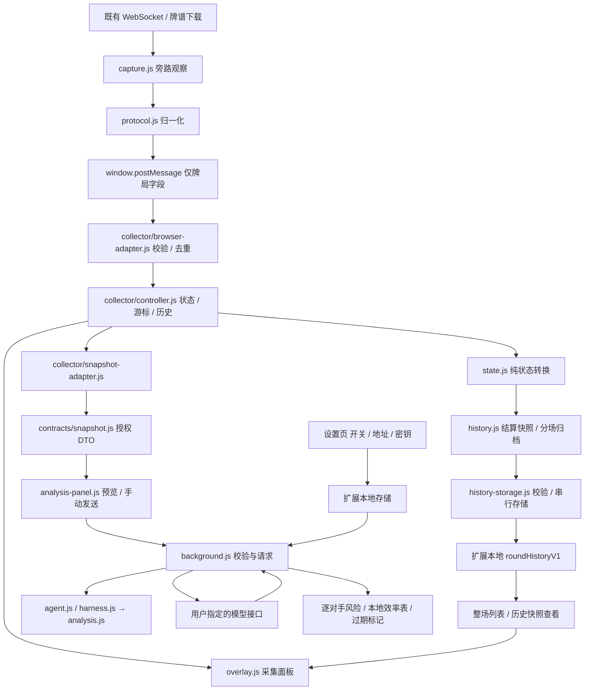

# 项目架构

0.4.0以 **Majsoul AI Analysis & Review Agent** 为整体名称，提供完整版与独立牌局获取器。`extension/agent.js`复用0.3.0分析能力编排任务，`extension/harness.js`负责有界执行、取消和脱敏轨迹；`agent/`提供离线复盘与回归评测。完整说明见 [Agent与harness](docs/AGENT.md)。

这是 Manifest V3 扩展，完整版捆绑经浏览器适配的固定 Pi 1.4.0 运行时；collector 不含模型依赖。`extension/` 可直接加载完整版；`npm run build` 根据显式profiles生成完整版和独立获取器。采集器、标准数据合同、Agent、UI和网络访问通过组合入口接线。

## 目录与职责

| 文件 / 目录 | 职责 | 运行位置 |
| --- | --- | --- |
| `extension/manifest.json` | 加载顺序、执行世界、可选主机授权、后台与设置入口 | 浏览器 |
| `extension/protocol.js` | 最小 Protobuf reader、Liqi 帧与牌局消息归一化 | MAIN / Node 测试 |
| `extension/capture.js` | WebSocket、既有牌谱下载的旁路观察，过滤非牌局数据 | 游戏 MAIN 世界 |
| `extension/state.js` | 纯状态转换、座风、手牌布局、宝牌和立直推导 | ISOLATED / Node 测试 |
| `extension/history.js` | 整场与各局记录、快照整理 | ISOLATED / 后台 |
| `extension/history-storage.js` | 整场记录的本地存储消息处理，与模型配置分键保存 | 扩展 Service Worker |
| `extension/collector/controller.js` | 实时与牌谱状态、游标、历史、订阅、命令和独立导出 | 纯核心 / Node |
| `extension/collector/browser-adapter.js` | 页面桥接校验、去重、浏览器存储和资源路径端口 | ISOLATED 世界 |
| `extension/overlay.js` | 默认收起的独立获取器、controller视图、命令绑定与刷新节流 | ISOLATED 世界 |
| `extension/floating-panel.js` | 通用拖动、折叠、位置记忆与视窗约束，不认识采集或分析业务 | ISOLATED 世界 |
| `extension/hand-hints.js` | 独立手动校准、Canvas几何映射、建议与高危标记，不读取controller或请求模型 | ISOLATED / Node 测试 |
| `extension/contracts/snapshot.js` | 标准授权DTO白名单、牌面规范化和标签 | 纯合同 / Node |
| `extension/collector/snapshot-adapter.js` | 获取器state与用户选择转换为标准DTO | 纯输入适配 / Node |
| `extension/apps/collector-app.js` / `agent-app.js` | 创建端口、controller和UI；完整版注入快照适配及分析面板 | 组合入口 |
| `extension/profiles/agent.json` / `collector.json` | 两种安装配置的脚本顺序、后台、权限和资源入口 | 构建输入 |
| `extension/mahjong-analysis.js` | 向听、形状进张、已见牌计数和逐对手防守特征 | ISOLATED / 后台 / Node 测试 |
| `extension/analysis.js` | 标准快照的任务准备、提示词、本地计算准备、JSON Schema和结果校验 | 后台 / 离线预览 / Node |
| `extension/adapters/model-endpoint.js` | 模型地址校验与主机权限模式 | 后台 / 设置 / Node |
| `extension/model-profiles.js` | 命名 chat 配置的无损迁移、校验与选择，纯转换，不读写存储 | 设置 / Node |
| `extension/model-session-transport.js` | 通用非流式 Chat Completions 消息、function tools 和响应解析，不发网络请求 | 后台 / Node |
| `extension/model-diagnostics.js` | 人工最小工具与 JSON 合同诊断、Magpie 身份、标准目录与显式 CC Switch Codex 目录发现；只依赖 endpoint/transport，权限与请求通过端口注入 | 后台 / Node |
| `extension/analysis-panel.js` | 数据范围与任务选择、发送预览、结构化牌面建议、本地效率表和过期提示 | ISOLATED 世界 |
| `extension/analysis-panel.css` | 分析卡样式，通过扩展本地资源载入Shadow DOM | 扩展静态资源 |
| `extension/background.js` | 可信能力组合、消息来源校验与分发、配置失效通知 | 扩展 Service Worker |
| `extension/model-config-store.js` | 注入 storage 的配置读取迁移、串行保存／关闭／清除 | 设置 / Node |
| `extension/model-analysis-worker.js` | 分析请求、pending、配置 revision、会话与记账协调 | 后台 / Node |
| `extension/agent.js` | 任务计划、已授权快照、本地分析和模型解释工具接线 | 后台 / Node |
| `extension/adapters/mjai.js` | 授权事件前缀转 mjai、匿名化、对手暗牌遮蔽及协议白名单 | 纯输入适配 / Node |
| `extension/contracts/engine-result.js` / `engine-agent.js` | 可选引擎输出白名单、快照与事件重放对照、合法动作验证和有界流程 | 后台 / Node |
| `extension/adapters/naga-replay.js` | 完整 replay 到逐局 Tenhou URL 的纯转换、规则与动作校验、逐局拒绝 | 纯输入适配 / Node |
| `extension/naga-panel.js` / `.css` | 默认关闭的规则确认、选局、预览、复制／下载及官方提交页链接 | Agent ISOLATED 世界 |
| `extension/harness.js` | 工具注册、步数与时间预算、取消、无内容运行轨迹 | 后台 / Node |
| `extension/collector-background.js` | 独立获取器的历史存储后台，无模型功能 | Collector Service Worker |
| `agent/review.cjs` / `agent/eval.cjs` | 按游标的本地复盘、人工回归报告 | Node CLI |
| `agent/mjai-process.cjs` / `mjai-python-wrapper.py` | 可信用户进程的单次 JSONL 调用；Python 包装用户 Bot，不包含模型 | 本机 Node / Python |
| `agent/engine-server.cjs` / `engine-review.cjs` | 可选本机 HTTP 桥接与导出事件协议复盘 | Node CLI |
| `scripts/check-boundaries.mjs` | 静态依赖白名单及纯核心能力边界检查 | Node |
| `scripts/build-extensions.mjs` | 按profiles追踪资源闭包、验证加载顺序、复制安装目录 | Node |
| `extension/options.html/js/css` | 命名配置草稿、手动切换、Magpie／CC Switch 可选预设；保存与手动诊断／发现的主机权限申请，目录身份隔离与过期结果丢弃 | 扩展设置页 |
| `extension/tiles/` | 本地牌面资源 | 扩展静态资源 |
| `tests/` | Node 协议、采集、状态、分析测试与离线浏览器预览 | 本地 |
| `research/` | 调研记录与被 Git 忽略的本地验证证据 | 开发使用 |
| `dist/` | 可解压安装的版本包 | 分发使用 |

## 数据流

MAIN 中的采集器仅观察已有通信，不主动获取牌谱，不调用游戏出牌接口。桥接数据不作为可信来源；模型消息不复用页面的 `postMessage` 通道。

controller独立于DOM和浏览器API；存储、时钟、ID和hash通过端口注入。实时数据和牌谱数据分别维护，牌谱只分析当前游标的状态。`getView()`和导出返回复制数据，UI修改不会改变内部状态。视图仅提供回放记录数量`recordCount`与有限的`recentEvents`供UI使用，完整记录留在controller和导出边界；`overlay.js`每次渲染只读取一次视图，通过controller命令操作。

`apps/collector-app.js`组装独立获取器；`apps/agent-app.js`在同一采集面板的扩展槽中挂载分析UI，传入`analysisView={snapshot(selection), seatLabels, phase, round}`与游标上下文。分析面板不读取采集器state布局，不导入采集器adapter；它保持授权选择和请求状态，通过快照指纹识别旧结果。销毁组合入口会断开桥接和订阅，并使分析面板的在途响应失效；重新挂载重新读取配置。

## 可选引擎数据流

LLM 分析与解释保持主要定位，默认 `chat` 且分析关闭。设置保留多份命名 `chat` 配置与可选 `mjai` 配置，一次只使用所选后端；切换不自动启用分析，也不会自动串联 LLM 和引擎。Mortal/mjai 是自备模型的可选适配，不增加独立获取器的依赖或权限。

组合入口提供授权观察的本局连续事件，由 `adapters/mjai.js` 转换为 `majsoul-mjai-v1`：`start_game`、13张 `start_kyoku` 与游标前事件；玩家名匿名化，对手手牌/摸牌遮蔽。后台 `engine-agent.js` 执行 `request.validate → engine.infer → engine.validate`，只依赖净化 DTO，重放自家手牌并对照局数、点数、供托、宝牌、有序公开牌河及立直状态。原始获取器 state 不进入引擎 Agent。

扩展经带 Bearer Token 的本机 `/analyze` 调用 `engine-server.cjs`，后者由 `mjai-process.cjs` 启动用户配置的进程，写入一行完整事件数组，读取单行动作并清理进程。Python 包装器调用用户零参数 Bot 类的 `react(events_json)`，用户模块自行加载权重和依赖。命令不是沙箱；不捆绑上游运行环境或权重，上游许可另行适用。此服务默认不启动，不接受由页面指定执行命令。

页面初版仅接受完整无副露四麻的合法 `dahai`、`reach` 意向及 `none`，自家14张开局记录和其他动作明确拒绝。无法确定立直弃牌时不输出具体牌；无可靠 Q 索引映射时候选为空，Q 值不作为放铳概率或危险牌依据。`engine:review` 从事件前缀重建快照，复用同一 Agent 的完整一致性与动作校验，输出 `engine/result/localAnalysis/trace`。HTTP 服务全局只运行一次推理，忙时429且不排队，断开后等待取消清理完成才释放。完整协议与命令见 [docs/MJAI.md](docs/MJAI.md)。真实模型权重及牌力未验证。

## 可选 NAGA 牌谱导出

`naga-panel.js` 由完整版组合入口挂载，默认关闭且独立于 `chat` / `mjai` 后端选择。用户在 replay 模式主动确认四人喰断、东风／半庄和赤牌配置后，面板通过注入的 `exportReplay()` 端口取得完整记录，交给纯转换器 `adapters/naga-replay.js`。转换不依赖当前游标，不接受实时局面或历史快照；输出逐局 Tenhou URL 与逐局拒绝原因。支持与拒绝边界见 [NAGA 接入说明](docs/NAGA-INTEGRATION.md)。

`protocol.js` 仅对 replay 选择额外的役种、里宝牌、支付点数与流局结算字段，缺失点数保持 `null`；不保留玩家身份、未来牌山或原始报文，也不扩大 live 输出。转换器自行匿名化座位标签，不依赖 DOM、Chrome、网络、模型 Agent 或 harness。新增数据不会进入 `mj-analysis-v1`。

面板仅生成预览、复制或下载文本，并打开固定官方链接；用户自行登录、核对官方费用和提交。扩展不读取会话、不自动上传或扣费、不轮询任务或回读报告，也不把报告贴到实时手牌。Collector 的资源闭包不含 NAGA 转换器及界面，无新增服务主机权限。

## 历史记录边界

`history.js` 逐字段整理结算快照，实时与牌谱分场保存，按局数和本场去重；下一局开局可补齐上一局未知点数。历史快照独立于当前状态，查看记录不会移动牌谱游标或停止实时采集。当前未使用稳定游戏ID，刷新或断线后可能将同一场分段。

`history:load` / `history:save` 由后台的 `history-storage.js` 处理，限制同扩展、指定游戏origin与顶层frame；通过队列串行读改写，使用独立的 `roundHistoryV1` 键，不读取或返回模型配置。保留最近20场、每场最多100局，并按约4MiB总量淘汰最旧场次。离线预览仅使用独立localStorage键，不与真实扩展共享记录。

## 模型模块边界

标准授权DTO保持 `mj-analysis-v1`。`collector/snapshot-adapter.js`知道获取器state布局，按选择生成DTO；`contracts/snapshot.js`负责独立白名单和规范化。Agent直接调用合同的`cleanSnapshot()`，不认识获取器state、controller或DOM；其他采集器只需提供同样的DTO。`analysis.js`的`prepare()`生成外发 `mj-analysis-v2`。任务为 `danger`、`efficiency`、`combined`，兼容旧 `discard` / `both`。防守使用有序牌河及 nullable 手摸切；效率只使用自家手牌、副露和已授权已见牌统计；综合任务通过一次模型请求组合两模块输入和提示词。

`MJMahjongAnalysis.analyze()` 仅接收清洗后的快照。`localAnalysis` 按任务挑选防守或效率结果；后台忽略页面消息自带的本地计算字段，重新计算。算法和合同采用有界缓存，预览通过 `model:prepare` 在后台异步计算，避免界面刷新阻塞游戏线程。后台请求和预览共用 `prepare()` 的真实数据。普通型、七对子、国士向听及有效牌由本地计算，未见枚数为上界，模型只作解释。

输出经固定 JSON Schema 和本地严格解析校验，兼容 JSON 代码围栏，无需服务商支持 `response_format`。检查任务、合法候选、逐对手风险、现物证据及无内容结果；13 张、立直摸牌未知、手牌非法或已结算时禁止具体弃牌建议。未知手摸切保留 `null`，协议已确认的默认 `false` 仍为手切。界面转义文本，仅加载本地 SVG 牌面；任务、取消或配置变更使在途响应失效，防止旧结果回填。

- **数据合同**：`mj-analysis-v1` 包含来源、完整性、阶段、自家座位、最近动作序号和有限的采集警告。可选的 `game` 不含手牌和牌河；`rivers` 仅含所选座位的弃牌及摸切、立直、已鸣标记；`selfHand` 仅含已选自家的手牌。显式逐字段拷贝，避免扩展局面对象时顺带外发账号或对手暗牌。
- **配置与凭据**：设置页把命名配置保存在 `llmProfilesV1`，当前生效配置仍为 `modelConfig`，`analysisProviders` 保留 chat/mjai 旧槽位；旧值由纯模块迁移，存储只由设置页／后台负责。后台将访问级别限制为 `TRUSTED_CONTEXTS`。内容脚本通过 `model:status` 仅取得开关和配置的模型名称，不将网关别名当已识别上游。设置回到游戏时刷新状态，也可手动刷新；即使面板状态过时，后台仍重新检查开关与授权。
- **授权**：manifest 只声明可选主机范围，设置页在用户点击保存、人工诊断或服务／模型发现时申请配置的主机。允许 HTTPS 和 HTTP loopback；拒绝 URL 用户信息、查询和片段。目标端口保留在实际请求地址中，授权模式遵循浏览器按主机匹配的规则。
- **游戏消息**：`model:settings` 打开设置，`model:status` 查询状态，`model:analyze` 发送当前快照与任务，`model:cancel` 取消当前标签页的请求。此路径只接受同扩展、指定游戏 URL、顶层 frame 的调用，不接受任意请求地址或密钥参数。
- **人工诊断与发现**：`model:diagnose`、`model:discover` 和按 requestId 取消的 `model:cancel` 只接受同扩展精确 `options.html` 来源，允许用户提交当前配置草稿；不走 Agent、harness 或采集器，也不读取牌局、记忆或历史。关闭分析后仍可手动发起可能收费的人工测试。后台注入 `permissions` / `fetchModel`，诊断复用通用 transport 完成固定 function tool → 无副作用结果 → 最小 JSON 合同，并单独限制并发、25 秒总超时和 256 KB 响应；配置变化与撤权会取消，错误不返回上游正文。Magpie 预设沿用相同 Chat Completions transport，额外手动 GET hello/models，不引入专用 Agent 或采集依赖。CC Switch 也复用该 transport，仅以显式 `cc-switch-models` 动作解析 Codex 的 `models[].slug`，不自动猜测 schema、读取桌面配置或进入 Agent／Pi loop。设置页目录绑定服务类型、profile、规范化 endpoint 和实际 Bearer 值，身份变化清除候选并阻止过期响应回填；同身份刷新失败保留目录。通过最小诊断不代表麻将合同、真实网关或模型质量已通过验收。
- **网络**：单标签页最多一个请求；25秒超时；拒绝重定向、不携带浏览器 cookies；请求快照上限60000字符，响应上限1MiB，展示上限16000字符。关闭、修改或清除设置会取消进行中的请求。
- **展示**：模型文本进行 HTML 转义，不执行模型输出的 HTML、脚本或链接。模型只作建议，不参与状态更新或出牌。

## 变更与验证

协议变更修改 `protocol.js` 并补人工协议帧；采集兼容性修改 `capture.js`；局面规则和推导修改 `state.js`。新增发送字段应先修改 `contracts/snapshot.js` 的显式合同和测试，再修改需要该字段的输入adapter；新模型协议应在后台适配，不将密钥或网络调用移入页面脚本。

`npm run check`检查源码语法、依赖白名单、纯核心禁止浏览器能力及profiles。`model-profiles.js` 不允许模块依赖，`model-diagnostics.js` 仅允许 endpoint 与 transport；两者禁止直接 DOM、Chrome、网络和存储全局能力，注入端口仍可用。构建从显式入口追踪脚本和页面资源闭包，验证内容脚本、worker和设置页的加载顺序；agent profile须与默认manifest一致，collector闭包不得包含分析或模型文件。检查器支持本项目的静态引用，不是通用JavaScript解析器；新增项目全局或加载方式需同步检查规则。两个安装目录由依赖闭包复制生成，不修改共享UI源码。

检查规则、依赖方向和静态扫描局限见[可执行的模块边界](docs/DECOUPLING.md)。

运行 `npm test`。分析测试通过 VM 中的模拟 Chrome API 和模拟 HTTP 响应覆盖开关、授权、身份、请求、错误与取消，不连接真实模型。`tests/preview.html` 用于离线界面验证，不代表真实协议采集或模型正确率。版本验证记录见 `VALIDATION.md`。

## 配置持久化边界

`model-config-store.js` 通过注入的 storage 提供 `load/save/disable/clear`，统一迁移读取、命名配置与兼容槽位的一次写入、关闭和清除的串行顺序；`model-profiles.js` 继续只做纯转换。`modelConfig` 是唯一运行时生效配置，`llmProfilesV1` 是用户保存集合，`analysisProviders` 是兼容草稿槽位。额外配置字段及 mjai 凭据保留。

设置页持有表单、命名草稿和目录身份，真实用户手势内先申请主机权限，再调用 store 保存；选择不写存储、不自动开启。关闭／清除会使尚未开始写入的保存失效，已开始写入则由队列中后续操作覆盖。清除仍通过注入回调取消后台及清理会话，只移除既有模型／会话键，不碰历史和记忆。队列与 generation 属于每个设置页实例，未提供跨窗口事务保证。

## 后台分析编排边界

`background.js` 保留可信组合入口及消息的扩展身份、URL、frame 检查与分发；`model-analysis-worker.js` 的 `create` 接收 storage、permissions、fetchModel、runtime 和同一份 roundContexts/runStore/discussions/memoryWorker 实例。`prepare/analyze` 承接授权 DTO 准备、配置校验、Pi 与 mjai 请求、timeout/abort、会话提交回滚与用量记账。`busy/cancel/cancelAll/invalidate` 公开生命周期控制；pending 与配置 revision 只在该服务各保留一份，记忆模块通过 busy 回调服从实时分析优先。

诊断、记忆、历史和讨论保留各自模块；HTTP 与密钥仍仅在可信后台执行。服务不依赖 Chrome／DOM／采集器全局，只使用注入能力；固定 Pi bundle、提示词、工具预算、lane、冻结追问与用量未知语义保持不变。两项新模块登记静态依赖白名单、加载顺序和 Agent-only 资源闭包，Collector 不会分发它们。
