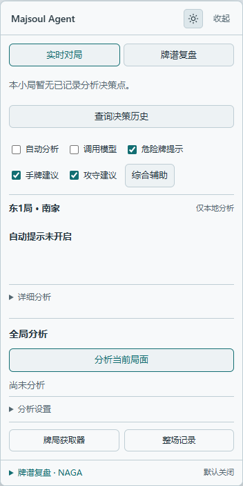

# Majsoul Agent · A Mahjong Soul AI learning assistant

**Get advice in Mahjong Soul, ask why, and understand the choices behind each move.**

A browser extension for the Mahjong Soul web client: compare tile efficiency and danger evidence, use your own LLM to explain a position, or connect a local Mortal / Akagi engine for action recommendations. Keep asking about the same decision, then return to it later.

**Start with little setup: local tile-efficiency analysis works as soon as the extension is loaded; AI explanations need your endpoint, model ID and API key; optional local engines have an extract-and-double-click runtime package.**

[**Download v0.16.9**](https://github.com/oreki-L/majsoul-ai-analysis-and-review-agent/releases/tag/v0.16.9) · [Quick start](#quick-start) · [Highlights](#why-choose-majsoul-agent) · [Local models](#using-local-models) · [FAQ](#faq) · [Documentation](docs/README.md)

[简体中文](README.md) | **English** | [日本語](README.ja.md)

| Light mode | Dark mode |
| --- | --- |
|  |  |

Switch themes with the button at the top right of the analysis card. These are offline demonstrations with synthetic positions; the dark-mode image includes a simulated model response.

## Why choose Majsoul Agent

- **Start small, add what you need**: local tile-efficiency analysis needs no API key. Connect an LLM with an endpoint, model ID and key. Normal use needs no Node.js, Python or Rust installation, proxy, certificate or browser remote-debugging setup.
- **Keep discussing each decision**: ask inside the analysis card, with earlier exchanges carried into that decision's discussion. Return to an old decision while play continues, without mixing in later tiles. Saved discussions can be restored after a refresh.
- **Choose your own models**: use an LLM alone, a local engine alone, or an engine with LLM explanations. Save multiple LLM profiles and download or switch local models as needed.
- **See the engine action before the explanation**: validated engine actions appear first, followed by LLM commentary that cannot rewrite the engine's first choice. Retry failed explanations separately; follow-up questions do not rerun the engine.
- **Inspect the evidence**: local calculations provide shanten, effective tiles and per-opponent genbutsu / suji / wall evidence. LLM read-only tools can consult these facts, and you can expand the analysis evidence to check them.
- **Track calls and costs**: analyze manually or opt into automatic hints, with starting-turn, interval and per-round limits for automatic calls. Engine time and LLM tokens / estimated costs are recorded separately and can be exported; unknown costs stay unknown.

### Measured results and scope

**The earlier S2 teaching setup passed 107 of 127 fixed positions (84.25%), averaging 3.550/4.** Three setups used the same positions, delivering all 381/381 answers for independent blind review by GPT-6.1 Sol / medium. Major factual errors fail the quality gate.

| Historical teaching setup | Quality passes | Pass rate | End-to-end mean / 4 |
| --- | ---: | ---: | ---: |
| S1: fact-reading rules | 87/127 | 68.50% | 3.209 |
| **S2: add current-action focus** | **107/127** | **84.25%** | **3.550** |
| S3: also isolate automatic teaching history | 99/127 | 77.95% | 3.387 |

The 127 positions came from 12 previously observed rounds, not a hidden independent sample. Each answer had one blind reviewer, without inter-rater agreement measurement. Delivery includes the single format-repair mechanism; three S2 answers were recovered by repair. These measure **teaching quality in an earlier experiment**, not playing strength or live-game win rate. v0.16.9 adds event-order safety checks, local completion tiles and production integration to S2; it has no new real-LLM score. This version passed **127/127** offline production-Agent checks with mock teaching and **0** real model/engine API calls; new fact/safety tests passed **12/12**, and workspace engineering tests total **841: 838 passed, 3 skipped, 0 failed**. See the [S2 validation record](docs/validation/MORTAL_TEACHING_S2_VALIDATION.md) for methods and limits.

### Understand a hand through follow-up questions

For example, ask within the same decision's discussion:

> “Why discard the nine of characters?”
>
> “What effective tiles would I lose by discarding the two of circles instead?”
>
> “The player before me has declared riichi. How should I balance attack and defense?”
>
> “Which exact tiles did you mean by safe tiles?”

Answers use **the hand and public table at that decision, the original recommendation and exchanges in that discussion**. Reopen the decision from history to continue. These are example questions; answers depend on your configured model.

**Analyze → ask about the decision → revisit history → continue the discussion** is the core learning workflow. Discussions are stored locally, within capacity limits.

## Downloads

Current release: **v0.16.9**. Start with the full Agent.

This version brings S2's count table and current-action index into engine teaching, with local shape completion tiles and safety evidence checked against event order. The new patch has offline fact checks but has not been retested with a real LLM; the earlier S2 pass rate of 84.25% is not this version's result. See the [changelog](CHANGELOG.md) and [S2 validation scope](docs/validation/MORTAL_TEACHING_S2_VALIDATION.md).

| Package | Who it is for |
| --- | --- |
| [**Full Agent extension**](https://github.com/oreki-L/majsoul-ai-analysis-and-review-agent/releases/download/v0.16.9/majsoul-ai-analysis-and-review-agent-0.16.9.zip) | Recommended entry point: local calculations, model analysis, follow-up questions, history and settings |
| [Optional local model runtime · Windows x64](https://github.com/oreki-L/majsoul-ai-analysis-and-review-agent/releases/download/v0.16.9/majsoul-model-manager-windows-x64-0.16.9.zip) | Download when you want local Mortal / Akagi; includes the Node runtime needed by the manager |
| [Standalone Collector](https://github.com/oreki-L/majsoul-ai-analysis-and-review-agent/releases/download/v0.16.9/majsoul-collector-0.16.9.zip) | Collection, display and export without AI analysis |
| [Source package](https://github.com/oreki-L/majsoul-ai-analysis-and-review-agent/releases/download/v0.16.9/majsoul-ai-analysis-and-review-agent-source-0.16.9.zip) | Development, builds and offline review |

[All release files and SHA-256 checksums](https://github.com/oreki-L/majsoul-ai-analysis-and-review-agent/releases/tag/v0.16.9). Extension packages contain no model weights. Agent and Collector have separate local storage; enable only one on the same game page.

## Quick start

Use Chrome or Edge and open [Mahjong Soul](https://game.maj-soul.com/). Only `game.maj-soul.com` is currently adapted. **The extension UI is Simplified Chinese**; the steps below retain its actual button labels.

### 1. Install the extension

1. Download and extract the **full Agent extension** above.
2. Open `chrome://extensions` in Chrome or `edge://extensions` in Edge, then enable Developer mode.
3. Choose **Load unpacked** and select the folder directly containing `manifest.json`.
4. Refresh Mahjong Soul before entering a game so collection starts before the game connection is established.

### 2. Try local analysis without an API key

1. Confirm your seat in the game collector and wait for a complete round start and hand to be collected. Open it with “牌局获取器” at the bottom of the analysis card if needed.
2. Leave “调用模型” off and enable “手牌建议”; enable “危险牌提示” too if desired.
3. Under “全局分析”, click “分析当前局面”. Expand the evidence to see shanten, effective-tile comparisons for candidate discards and danger evidence.

**Seeing the local tile-efficiency calculation completes your first use.** This path makes no model requests and incurs no API charges. Local efficiency comparisons do not provide a complete attack/defense judgment.

### Standard use: AI analysis and follow-up questions

After installation and local analysis, configure your own model service:

1. Expand “分析设置” on the card and click “模型设置” to open “模型管理”.
2. Expand “手动连接自备服务” and fill in:

   | Field | What to enter |
   | --- | --- |
   | 服务地址 | Your provider's Chat Completions-compatible address, e.g. `https://api.openai.com/v1` |
   | 模型名称 | The exact model ID; enter it manually or choose from the service's model directory |
   | API Key | Your service key; leave blank if a local service requires no authentication |

3. Check “开启模型分析”, click “保存设置” and allow browser access to the endpoint. **The endpoint must support function tools.** To check connectivity, use “发送测试请求（可能收费）”; the test may incur charges.
4. Back in the game, enable “调用模型” and the desired “手牌建议”, “危险牌提示” and “攻守建议”, then click “分析当前局面”.
5. Ask about the resulting decision, for example “Why not discard another tile?” Reopen it later from the recorded analyses to continue.

**Receiving a model recommendation and a follow-up answer on that decision completes the AI setup.**

For ongoing hints, explicitly enable “自动分析”. Its starting turn, frequency and per-round call count can be limited under “分析设置”. Manual “分析当前局面” always requests combined analysis and is not subject to those automatic-call limits. Model calls send your hand, public game information, all public discard rivers and relevant collected events as of that decision to your configured service. Follow-ups also include the original recommendation and that decision's exchanges. Your provider charges for usage. There are currently no per-field authorization switches in the UI.

Multiple named profiles are supported. Magpie and experimental CC Switch are optional gateways; see [model configuration](docs/guides/MODEL_CONFIGURATION.md).

### Using local models

Install the optional runtime when you want Mortal / Akagi. **Extract it, double-click to start, and install a model in the manager; no separate Node.js, Python or Rust setup is needed.** The portable package currently targets Windows x64. First installation still downloads weights and required dependencies over the network.

1. Install the full Agent above. Download and fully extract the runtime into a writable folder, then double-click `start.cmd`.
2. The local manager opens automatically. Keep the runtime window open, select a model, click “安装”, then “启动分析” when installation finishes. Only the selected model's requirements are installed.
3. In extension “模型设置 → 本地麻将模型”, select **the same model**, click “连接所选模型”, grant local-endpoint permission and approve the connection in the manager. Analysis settings are filled automatically, **without copying tokens**.
4. For engine actions alone, check “开启模型分析” and save. For explanations, first save your LLM service under “模型管理”, then enable “使用模型服务解释引擎建议” under “本地麻将模型”, enable analysis and save.
5. Back in the game, confirm your seat and complete collection state, enable “调用模型” and “攻守建议”, then click “分析当前局面”. Engines need complete four-player events collected from the round start; supported model scopes are listed below.

**The manager showing a running model, a completed extension connection and an analysis displaying the matching model source confirms the engine path is connected.**

Connecting does not enable analysis automatically. After switching models, reconnect and enable analysis again. To finish, click “停止分析服务” in the manager or close the runtime window. Turning off extension “调用模型” stops requests but leaves the service running.

| Optional model | Scope and characteristics |
| --- | --- |
| Old weak Mortal example bundled with Akagi v2 | Retained starter and regression path |
| [VoidShine/mortal-298k](https://huggingface.co/VoidShine/mortal-298k) | Community Mortal v4, four-player hanchan; its author advises against ranked play |
| [Yuchen1457/mortal-582500](https://huggingface.co/Yuchen1457/mortal-582500) | Community Mortal v4; supported here for four-player hanchan |
| Akagi v3 Native | Experimental, four-player hanchan; ~2.64 MB weights, separate Rust CPU runtime, no Python / PyTorch |

Community v4 is not official Mortal 4.1. Akagi v3 is a separate behavior-cloning model; version numbers do not rank playing strength. The two v4 models share a runtime, and VoidShine does not require installing Akagi first.

Assets default to `%LOCALAPPDATA%\MajsoulAgent\models`; extracting a newer runtime can reuse validated assets. Older package-local installations are not migrated automatically. When upgrading from v0.14.0, update both the extension and runtime package.

[Installation, switching and troubleshooting](docs/guides/MODEL_MANAGER.md) · [Engine and LLM explanations](docs/guides/MJAI.md) · [Community v4 details](docs/guides/MORTAL_V4.md)

## More features

| Feature | How it helps |
| --- | --- |
| Draggable, collapsible analysis card | Read recommendations and evidence in the game, with light and dark themes |
| Hand-position hints | After manual calibration, mark recommended tiles and danger hints over the hand area |
| Game history and replay analysis | View collected settlement records; after the game loads a replay, select an analysis position manually. The cursor does not control the game screen |
| Analysis history and topic index | Reopen old decisions for follow-ups and browse saved advice and questions by topic; covers retained analyses, not a full-game move-by-move assessment |
| Optional full-match memory learning | Summarize your actual actions when collection requirements are met; generate candidate observations, save explanation preferences, and edit or delete memories. Off by default |
| Optional NAGA export | Convert qualifying complete four-player replays for preview, copy or download, then submit them yourself; no automatic uploads or payments |
| Official Mortal review entry | Open the official site with a native Mahjong Soul share link. Also import limited legacy English Classic 1.5.3 / Mortal 3 reports for aligned, on-demand explanations; not all current official reports are supported |
| Standalone Collector | Record without model code or model-host permissions, view settlement history and export |

More: [memory learning](docs/guides/USER_MEMORY.md) · [sessions and usage](docs/guides/AGENT_SESSIONS.md). For differences from real-time HUDs, offline reviewers and LLM assistants, see the [ecosystem comparison](docs/research/RIICHI_ECOSYSTEM_RESEARCH.md) and [reference index](docs/REFERENCES.md).

## FAQ

**No game data after installation?** Check the domain is `game.maj-soul.com`, the extension is enabled and you refreshed the game after installing. Collection must begin before the connection is established. If round-start data is missing, wait for the next round; missing events are not reconstructed.

**Why does it still show local-only analysis?** Save settings with “开启模型分析” checked, grant endpoint access and enable “调用模型” in the game panel. These separately control configuration activation and actual calls. Automatic analysis has its own opt-in switch.

**Will any API that supports chat work?** It also needs Chat Completions function tools. Run the settings-page test first; passing confirms basic tool-call compatibility, not mahjong advice quality.

**Can I use an engine without an LLM?** Yes, engine actions are generated locally. For explanations or follow-up questions, configure an LLM and enable “使用模型服务解释引擎建议”. The relevant position and exchanges will be sent to that service.

**Model download or connection failed?** Check that the runtime window is open, the model is installed and running, the extension selected the same model and the manager approved the connection. Community v4 weight downloads depend on Hugging Face connectivity. See [troubleshooting](docs/guides/MODEL_MANAGER.md).

**Other servers or desktop clients?** Other regional domains, Firefox, Safari and Steam desktop are not currently adapted. Translated READMEs do not imply support for other game regions.

## Data and current support

Position-analysis inputs contain your hand, public table and collected history up to that decision, excluding opponents' hidden hands, account credentials and future events. With memory enabled, saved explanation preferences and observations may also be read. API keys, discussions and usage records stay in extension storage. The project has no relay server or telemetry uploads; cloud models receive the relevant data at your configured endpoint. NAGA replay export is different: it contains all four hands, so preview it before deciding whether to submit. Local history has capacity limits, with no cloud sync or permanent-retention guarantee. [Data and permissions](SECURITY.md)

The extension assists analysis and learning; it does not play automatically. Optional memory captures qualifying personal live games only after you enable it. Candidate observations can inform later explanations and can be confirmed as explicit preferences, edited or deleted. Disabling learning stops new collection; existing memories remain until deleted or cleared and cannot replace current-position facts. [Memory guide](docs/guides/USER_MEMORY.md)

Validation covers fixed-weight real inference, synthetic positions and protocols, and mock-LLM integration. Akagi v3 passed online installation from an empty directory; full offline installation passed for both community v4 models, but the full online Hugging Face weight-download path has not passed. Full live web games, reconnection recovery, playing strength and paid-LLM teaching quality remain to be validated. Explanations do not reproduce the engine's internal reasoning or promise a win rate.

[Validation overview](VALIDATION.md) · [v4 evidence](docs/validation/MORTAL_V4_VALIDATION.md) · [v3 evidence](docs/validation/AKAGI_V3_VALIDATION.md) · [Sessions and usage](docs/guides/AGENT_SESSIONS.md)

## Development and documentation

Node.js 22.19+ is needed only for development and source builds, not for loading the standard extension ZIP.

```sh
npm ci
npm run check
npm test
npm run build
```

Agent uses the Pi Agent runtime adapted for Manifest V3, with read-only tools accessing frozen positions. Collection and analysis are separated, and Collector stays independent.

[Documentation](docs/README.md) · [Feature and implementation audit](docs/development/FEATURE_AUDIT.md) · [Architecture](ARCHITECTURE.md) · [Module separation](docs/development/DECOUPLING.md) · [Contributing](CONTRIBUTING.md) · [Changelog](CHANGELOG.md) · [References](docs/REFERENCES.md)

Supplementary documentation is in Simplified Chinese. Project code and 37 original SVG tile faces are [MIT licensed](LICENSE). Optional models, native components and upstream code retain their own licenses. [Third-party notices](THIRD_PARTY_NOTICES.md) · [License sources](licenses/SOURCES.md)
