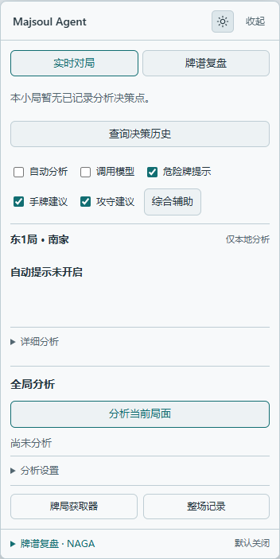

# Majsoul Agent · 雀魂 AI 学習アシスタント

**雀魂で助言を読み、理由を質問し、一手ごとの選択を理解する。**

雀魂ブラウザ版を直接分析する拡張機能です。牌効率や危険の根拠を確認し、自分の LLM に局面を解説させたり、ローカル Mortal / Akagi エンジンから動作の提案を受けたりできます。分からない助言には、その時点の局面について質問を重ね、後から振り返れます。

**導入も設定も手軽に。ローカル牌効率は拡張を読み込むだけで使えます。AI 解説は接続先・モデル名・API Key を設定し、任意のローカルエンジンは実行パッケージを展開してダブルクリックで始められます。**

[**v0.16.2 をダウンロード**](https://github.com/oreki-L/majsoul-ai-analysis-and-review-agent/releases/tag/v0.16.2) · [使い始める](#使い始める) · [特徴](#majsoul-agent-の特徴) · [ローカルモデル](#ローカルモデルの使い方) · [よくある質問](#よくある質問) · [ドキュメント](docs/README.md)

[简体中文](README.md) | [English](README.en.md) | **日本語**

| ライトモード | ダークモード |
| --- | --- |
|  |  |

分析カード右上のボタンでテーマを切り替えられます。画像は人工局面を使ったオフラインデモです。ダークモードの画像には模擬モデル応答を含みます。

## Majsoul Agent の特徴

- **小さく始め、必要に応じて追加**：ローカル牌効率に API Key は不要です。LLM は接続先・モデル名・キーを設定するだけ。通常利用では Node.js・Python・Rust の導入や、プロキシ・証明書・ブラウザのリモートデバッグ設定は不要です。
- **一手ごとに質問を続けられる**：分析カード内で質問し、その判断の過去の問答を踏まえて議論できます。対局が進んでも以前の判断に戻れ、後から出た牌を混ぜません。保存済みの議論は再読み込み後も復元できます。
- **自分のモデルを選べる**：LLM 単独、ローカルエンジン単独、エンジン＋LLM 解説を選択できます。複数の LLM 設定を保存し、ローカルモデルは必要なものだけ導入・切り替えできます。
- **エンジンの判断を先に、AI 解説を後に**：検証済みの動作を先に表示し、LLM が続けて解説します。LLM はエンジンの第一候補を変更できません。解説だけの再試行ができ、追加質問でエンジンを再実行する必要もありません。
- **牌理の根拠を確認できる**：シャンテン数・受け入れ・相手別の現物／スジ／壁などをローカル計算し、LLM の読み取り専用ツールで参照します。分析根拠を展開して確認できます。
- **呼び出しと費用が見える**：手動分析に加え、自動助言を明示的に有効にできます。自動呼び出しは開始巡目・間隔・局ごとの上限を設定可能。エンジン時間と LLM トークン／推定費用は別々に記録・出力し、不明な費用は不明のまま表示します。

### 一手について、納得するまで質問する

同じ判断の議論で、例えば次のように質問できます。

> 「なぜ九萬を切るのですか？」
>
> 「代わりに二筒を切ると、どの受け入れを失いますか？」
>
> 「上家がリーチしています。ここでの押し引きは？」
>
> 「先ほど安全牌と言ったのは、具体的にどの牌ですか？」

回答には **当時の手牌・公開情報・元の助言・その議論の問答** を使います。履歴から同じ判断を開き、質問を続けられます。上記は質問例であり、実際の回答は設定したモデルが生成します。

**その場で分析 → 判断について質問 → 履歴で振り返る → 議論を続ける**、という学習の流れが中心です。議論は本機に保存され、容量制限があります。

## ダウンロード

現在のリリース：**v0.16.2**。初めて使う場合は完全版 Agent から始めてください。

| パッケージ | 用途 |
| --- | --- |
| [**完全版 Agent 拡張**](https://github.com/oreki-L/majsoul-ai-analysis-and-review-agent/releases/download/v0.16.2/majsoul-ai-analysis-and-review-agent-0.16.2.zip) | 推奨の入口。ローカル計算・モデル分析・追加質問・履歴・設定を含む |
| [任意のローカルモデル実行パッケージ · Windows x64](https://github.com/oreki-L/majsoul-ai-analysis-and-review-agent/releases/download/v0.16.2/majsoul-model-manager-windows-x64-0.16.2.zip) | 本機で Mortal / Akagi を使う場合に取得。管理用の Node を同梱 |
| [独立 Collector](https://github.com/oreki-L/majsoul-ai-analysis-and-review-agent/releases/download/v0.16.2/majsoul-collector-0.16.2.zip) | AI 分析を使わず、収集・表示・エクスポートだけを利用 |
| [ソースパッケージ](https://github.com/oreki-L/majsoul-ai-analysis-and-review-agent/releases/download/v0.16.2/majsoul-ai-analysis-and-review-agent-source-0.16.2.zip) | 開発・ビルド・オフライン検討 |

[全リリースファイルと SHA-256 チェックサム](https://github.com/oreki-L/majsoul-ai-analysis-and-review-agent/releases/tag/v0.16.2)。拡張にはモデルの重みを含みません。Agent と Collector の保存領域は独立しており、同じゲームページでは片方だけ有効にしてください。

## 使い始める

Chrome または Edge で [雀魂ブラウザ版](https://game.maj-soul.com/) を開きます。現在の対応先は `game.maj-soul.com` のみです。**拡張 UI は簡体字中国語**で、以下は実際の操作名を併記しています。

### 1. 拡張をインストール

1. 上記の **完全版 Agent 拡張** を取得して展開します。
2. Chrome では `chrome://extensions`、Edge では `edge://extensions` を開き、デベロッパーモードを有効にします。
3. 「パッケージ化されていない拡張機能を読み込む」で、**`manifest.json` を直接含むフォルダ**を選択します。
4. 雀魂ページを再読み込みしてから対局に入り、ゲーム接続より前から収集を開始します。

### 2. API Key なしでローカル分析を試す

1. 牌局取得パネルで自分の座席を確認し、局の開始と手牌が完全に収集されるのを待ちます。必要なら分析カード下部の「牌局获取器」で開きます。
2. 「调用模型」は無効のまま、「手牌建议」を有効にします。必要なら「危险牌提示」も有効にします。
3. 「全局分析」の「分析当前局面」を押し、分析根拠を展開してシャンテン数・打牌候補ごとの受け入れ比較・危険の根拠を確認します。

**ローカル牌効率の計算が表示されたら、最初の利用は完了です。** この経路ではモデルへのリクエストも API 料金も発生しません。ローカル牌効率比較だけでは、総合的な押し引き判断は行いません。

### 通常利用：AI 分析と追加質問

インストールとローカル分析を終えたら、自分のモデルサービスを設定します。

1. 分析カードの「分析设置」を展開し、「模型设置」から「模型管理」を開きます。
2. 「手动连接自备服务」を展開し、次の三項目を入力します。

   | 設定項目 | 入力内容 |
   | --- | --- |
   | 服务地址 | サービスの Chat Completions 互換アドレス。例：`https://api.openai.com/v1` |
   | 模型名称 | 正確なモデル ID。手入力またはサービスのモデル一覧から選択 |
   | API Key | 自分のサービスキー。認証不要のローカルサービスなら空欄可 |

3. 「开启模型分析」にチェックし、「保存设置」を押して接続先へのブラウザ権限を許可します。**接続先には function tools 対応が必要です。** 接続確認には「发送测试请求（可能收费）」を使えますが、料金が発生する場合があります。
4. 対局画面に戻り、「调用模型」と必要な「手牌建议」「危险牌提示」「攻守建议」を有効にして「分析当前局面」を押します。
5. 助言が表示されたら、その判断に「なぜ別の牌を切らないのですか？」などと質問します。記録済み分析から開き直して議論を続けることもできます。

**モデルの助言と、その判断への追加質問の回答が表示されたら、AI 利用の設定は完了です。**

継続的な助言が必要なら「自动分析」を明示的に有効にします。「分析设置」で自動呼び出しの開始巡目・頻度・局ごとの回数を制限できます。手動の「分析当前局面」は常に総合分析を要求し、この自動呼び出し制限の対象外です。モデル呼び出しでは、当時の自分の手牌・公開対局情報・全員の公開捨て牌・関連する収集済みイベントを設定先へ送信します。追加質問には元の助言とその判断の問答も含み、料金はサービス側で発生します。現在、項目別の送信許可スイッチはありません。

複数の名前付き設定を保存できます。Magpie と実験的な CC Switch は任意のゲートウェイです。詳細は [モデル設定](docs/guides/MODEL_CONFIGURATION.md) を参照してください。

### ローカルモデルの使い方

Mortal / Akagi が必要になったら、任意の実行パッケージを導入します。**展開してダブルクリックし、管理ページでモデルをインストールするだけで、Node.js・Python・Rust の個別セットアップは不要です。** 現在のポータブル版は Windows x64 向けです。初回のモデル導入には、重みと必要な依存環境のダウンロードが必要です。

1. 上記の完全版 Agent を導入します。実行パッケージを書き込み可能なフォルダへ完全に展開し、`start.cmd` をダブルクリックします。
2. 本機のモデル管理ページが自動で開きます。実行ウィンドウを開いたまま、モデルを選んで「安装」を押し、完了後に「启动分析」を押します。選択したモデルに必要なものだけを導入します。
3. 拡張の「模型设置 → 本地麻将模型」で **同じモデル** を選び、「连接所选模型」を押します。ローカル接続先の権限を許可し、管理ページで接続を承認すると設定が自動入力されます。**Token のコピーは不要です。**
4. エンジンの動作だけなら「开启模型分析」を有効にして保存します。LLM 解説も使う場合は、先に「模型管理」で自分の LLM サービスを保存し、「本地麻将模型」で「使用模型服务解释引擎建议」を有効にして、分析を有効化・保存します。
5. 対局画面で座席と収集状態の完全性を確認し、「调用模型」と「攻守建议」を有効にして「分析当前局面」を押します。エンジンには局の開始からの完全な四人麻雀イベントが必要です。モデルごとの対応範囲は下表を参照してください。

**管理ページでモデルが起動し、拡張の接続が完了し、分析に対応するモデル名が表示されれば、ローカルエンジンへの接続を確認できます。**

接続だけでは分析は有効になりません。モデル切り替え後も再接続して有効にしてください。終了時は管理ページの「停止分析服务」を押すか実行ウィンドウを閉じます。拡張の「调用模型」を無効にするだけでは、ローカルサービスは終了しません。

| 選べるモデル | 対象範囲と特徴 |
| --- | --- |
| Akagi v2 付属の旧・弱 Mortal サンプル | 既存の導入・回帰確認用 |
| [VoidShine/mortal-298k](https://huggingface.co/VoidShine/mortal-298k) | コミュニティ Mortal v4、四人半荘。作者は段位戦での使用を非推奨 |
| [Yuchen1457/mortal-582500](https://huggingface.co/Yuchen1457/mortal-582500) | コミュニティ Mortal v4。本プロジェクトでは四人半荘が対象 |
| Akagi v3 Native | 実験的な選択肢、四人半荘。約 2.64 MB の重みと独立 Rust CPU 環境で、Python / PyTorch 不要 |

コミュニティ v4 は公式 Mortal 4.1 ではありません。Akagi v3 は別の行動模倣モデルで、バージョン番号は強さの順位を示しません。二つの v4 は実行環境を共有し、VoidShine のために先に Akagi を導入する必要はありません。

モデル資産の初期保存先は `%LOCALAPPDATA%\MajsoulAgent\models` です。新版を別途展開しても検証済み資産を再利用できます。旧パッケージ内の導入データは自動移行しません。v0.14.0 から更新する場合は、拡張と実行パッケージの両方を更新してください。

[導入・切り替え・トラブル対処](docs/guides/MODEL_MANAGER.md) · [エンジンと LLM 解説](docs/guides/MJAI.md) · [コミュニティ v4](docs/guides/MORTAL_V4.md)

## その他の機能

| 機能 | できること |
| --- | --- |
| 移動・折りたたみ可能な分析カード | 対局画面で助言と根拠を確認。ライト／ダークテーマ対応 |
| 手牌位置へのヒント | 手動で位置調整後、手牌領域に推奨牌や危険のヒントを表示 |
| 対局履歴と牌譜分析 | 収集済みの精算記録を表示。ゲームで牌譜を読み込んだ後、分析位置を手動選択。カーソルはゲーム画面を操作しない |
| 分析履歴とテーマ別整理 | 旧判断の議論を再開し、保存した助言や質問をテーマ別に確認。保存済み分析が対象で、全手順の対局評価ではない |
| 任意の対局全体の記憶学習 | 完全性の条件を満たした本人の実際の行動から観察候補を作成。解説の好みを手動保存し、記憶を修正・削除可能。初期状態は無効 |
| 任意の NAGA 出力 | 条件を満たす完全な四人麻雀牌譜を変換・プレビュー・コピー・保存し、自分で提出。自動アップロードや支払いはしない |
| 公式 Mortal 検討への入口 | 雀魂の正式な共有リンクから公式ページを開く。限定的な旧英文 Classic 1.5.3 / Mortal 3 レポートも読み込み・照合後に必要な箇所を解説できるが、現行の全公式レポートには未対応 |
| 独立 Collector | モデルコードやモデルホスト権限なしで記録し、精算履歴を確認・出力 |

詳しくは [記憶学習](docs/guides/USER_MEMORY.md)・[会話と使用量](docs/guides/AGENT_SESSIONS.md) を参照してください。他のリアルタイム HUD・オフライン検討・LLM アシスタントとの方向性の違いは [エコシステム比較](docs/research/RIICHI_ECOSYSTEM_RESEARCH.md) と [参考索引](docs/REFERENCES.md) にまとめています。

## よくある質問

**導入後に対局データが出ない？** `game.maj-soul.com` で拡張が有効か確認し、導入後にゲームを再読み込みしてください。接続前からの収集が必要です。局開始のデータがない場合は次の局を待ってください。欠けたイベントを推測で補完しません。

**ローカル分析のみと表示される？** 設定の「开启模型分析」を有効にして保存し、接続権限を許可したうえで、対局パネルの「调用模型」を有効にしてください。設定の有効化と実際の呼び出しは別です。自動分析も別途有効化が必要です。

**チャットできる API なら使える？** Chat Completions の function tools にも対応する必要があります。設定ページのテストで基本的なツール呼び出しを確認できますが、麻雀の助言品質を保証するものではありません。

**LLM なしでローカルエンジンを使える？** はい。エンジンの動作は本機で生成します。解説や追加質問には別途 LLM を設定し、「使用模型服务解释引擎建议」を有効にする必要があります。関連する局面と問答はその LLM に送信されます。

**モデルの取得や接続に失敗した？** 実行ウィンドウが開いていること、モデルが導入・起動済みであること、拡張で同じモデルを選んで管理ページで承認したことを確認してください。コミュニティ v4 の重み取得には Hugging Face への接続が必要です。[モデル管理ガイド](docs/guides/MODEL_MANAGER.md) を参照してください。

**他サーバーやデスクトップ版は？** 他地域ドメイン・Firefox・Safari・Steam デスクトップ版は現在未対応です。翻訳 README はその地域のゲームサーバーへの対応を意味しません。

## データと現在の対応範囲

局面分析の入力は、自分の手牌・公開情報・その判断時点までの収集済み履歴に限定し、相手の伏せた手牌・アカウント認証情報・未来のイベントは送りません。記憶を有効にした場合は保存済みの解説の好みや観察も参照できます。API Key・議論・使用量は拡張にローカル保存します。プロジェクト独自の中継サーバーやテレメトリー送信はなく、クラウドモデル利用時は関連データを設定先へ送ります。NAGA 牌譜出力は局面分析と異なり四家の手牌を含むため、内容を確認して提出を判断してください。履歴には容量制限があり、クラウド同期や永久保存は保証しません。[データと権限](SECURITY.md)

分析・学習を支援する拡張で、自動打牌はしません。任意の記憶学習は有効化後の条件を満たす本人のリアルタイム対局だけを収集します。観察候補は後の解説でも参照でき、明示的な好みとして確認・修正・削除できます。学習を無効にすると新しい収集は止まりますが、既存の記憶は削除・消去するまで残り、現在の局面の事実に代わるものではありません。[記憶学習ガイド](docs/guides/USER_MEMORY.md)

検証範囲には固定重みでの実推論・人工局面・合成プロトコル・模擬 LLM 連携などを含みます。Akagi v3 は空ディレクトリからのオンライン導入を検証済み、二つの v4 は完全なオフライン導入を検証済みですが、Hugging Face の重みを含むオンライン導入全体はまだ通過していません。実際のブラウザでの対局全体・再接続復旧・実戦の強さ・有料 LLM の解説品質は今後の検証対象です。LLM 解説はエンジン内部の思考の再現でも、勝率の保証でもありません。

[検証一覧](VALIDATION.md) · [v4 検証](docs/validation/MORTAL_V4_VALIDATION.md) · [v3 検証](docs/validation/AKAGI_V3_VALIDATION.md) · [会話と使用量](docs/guides/AGENT_SESSIONS.md)

## 開発とドキュメント

Node.js 22.19+ が必要なのは開発・ソースビルド時だけです。通常の拡張 ZIP を読み込む場合は不要です。

```sh
npm ci
npm run check
npm test
npm run build
```

Agent は Manifest V3 に適応した Pi Agent ランタイムを使い、読み取り専用ツールで固定した局面を参照します。収集と分析は分離し、Collector は独立しています。

[ドキュメント](docs/README.md) · [機能と実装の確認](docs/development/FEATURE_AUDIT.md) · [アーキテクチャ](ARCHITECTURE.md) · [モジュール分離](docs/development/DECOUPLING.md) · [コントリビューション](CONTRIBUTING.md) · [変更履歴](CHANGELOG.md) · [参考資料](docs/REFERENCES.md)

補足ドキュメントは簡体字中国語です。コードとオリジナル SVG 牌面 37 枚は [MIT ライセンス](LICENSE) です。任意モデル・ネイティブ部品・上流コードには個別のライセンスが適用されます。[第三者告知](THIRD_PARTY_NOTICES.md) · [ライセンス出典](licenses/SOURCES.md)
