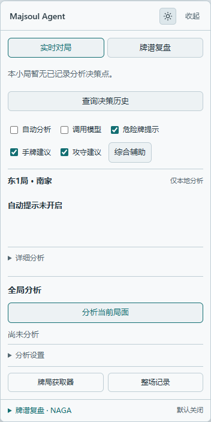

# Majsoul Agent · 雀魂 AI 学习助手

**在雀魂里看建议、问原因，把每一手的取舍弄明白。**

浏览器扩展直接分析雀魂网页版：查看牌效与危险依据，用自己的 LLM 讲解局面，或接入本地 Mortal / Akagi 引擎给出动作。遇到不懂的建议，可以围绕当时那一手连续追问，之后再回看。

**安装简单，配置按需：本地牌效加载即用；AI 讲解填好服务地址、模型名称和 API Key 即可开始；本地引擎提供解压双击的可选运行包。**

[**下载 v0.16.9**](https://github.com/oreki-L/majsoul-ai-analysis-and-review-agent/releases/tag/v0.16.9) · [快速开始](#快速开始) · [功能亮点](#为什么选择-majsoul-agent) · [本地模型使用](#本地模型使用) · [常见问题](#常见问题) · [详细文档](docs/README.md)

[简体中文](README.md) | [English](README.en.md) | [日本語](README.ja.md)

| 白天模式 | 黑夜模式 |
| --- | --- |
|  |  |

两种主题均可通过分析卡右上角按钮切换。以上为人工局面的离线演示，黑夜模式图包含模拟模型响应。

## 为什么选择 Majsoul Agent

- **轻装开始，按需升级**：加载扩展即可使用本地牌效，无需 API Key；接入 LLM 只需服务地址、模型名称和密钥。普通使用无需安装 Node.js、Python 或 Rust，也无需配置代理、证书或浏览器远程调试。
- **每一手都能连续追问**：直接在分析卡内提问，前轮问答会进入该决策的后续讨论，无需复制局面到外部聊天工具。牌局继续推进后，仍可回到旧决策提问，不混入后来出现的牌；刷新后可恢复已保存讨论。
- **自己的模型，自己的选择**：纯 LLM、本地引擎、引擎 + LLM 讲解均可使用；支持多份 LLM 配置，本地模型按需下载和切换，无需一次装齐。
- **先看引擎动作，再读 AI 解释**：引擎动作校验后先显示，LLM 随后讲解，不能改写引擎首选；解释失败可单独重试，追问无需重新运行引擎。
- **有据可查的牌理**：本地计算向听、有效牌和逐家现物／筋／壁等证据，配合 LLM 只读工具解释取舍；展开分析依据即可对照查看。
- **调用与费用看得见**：手动分析或自行开启自动提示；自动调用可设置起始巡数、间隔和每局上限。引擎耗时与 LLM token／估算费用分开记录、支持导出，未知费用保留未知。

### 已测结果与范围

**旧 S2 教学方案在 127 个固定局面中通过 107 个（84.25%），平均 3.550/4。** 同一批局面分别测试三套方案，共 381/381 份答案交付，由 GPT-6.1 Sol / medium 独立盲评；重大事实错误按不通过处理。

| 历史教学方案 | 质量通过 | 通过率 | 端到端均分 / 4 |
| --- | ---: | ---: | ---: |
| S1：补充事实读取规则 | 87/127 | 68.50% | 3.209 |
| **S2：再聚焦当前动作** | **107/127** | **84.25%** | **3.550** |
| S3：再隔离自动历史教学 | 99/127 | 77.95% | 3.387 |

127 点来自 12 个已观察过的小局，非隐藏独立样本；每答由一名代理盲评，未做双评一致性测量。全部交付包含一次格式修正机制，S2 有 3 答经修正挽回。这些是**旧实验的教学质量数据**，不是牌力或实战胜率。v0.16.9 在 S2 基础上新增安全时序、局部补牌和生产接入，尚无真实 LLM 新分数。本版生产 Agent + mock 教学离线核验 **127/127**，真实模型／引擎 API 调用 **0**；新增事实／安全测试 **12/12**，工作区工程测试 **841 项：838 通过、3 跳过、0 失败**。完整方法与边界见 [S2 验证记录](docs/validation/MORTAL_TEACHING_S2_VALIDATION.md)。

### 围绕一手牌，把问题问清楚

例如，你可以在同一个决策的讨论中依次提问：

> “为什么建议打九万？”
>
> “如果改打二筒，会损失哪些进张？”
>
> “上家已经立直，这里的攻守取舍是什么？”
>
> “你刚才提到的安全牌，具体是指哪几张？”

回答使用**当时的手牌、公开桌面、原建议与本分支问答**。之后从历史中找回这一手，还能接着讨论。这里展示的是提问示例，具体回答由所配置模型生成。

**当场分析 → 针对决策追问 → 历史回看 → 继续讨论**，是 Majsoul Agent 的核心学习流程。讨论保存在本机，受存储容量限制。

## 下载

当前发布版本：**v0.16.9**。第一次使用，先下载完整 Agent 即可。

本版将 S2 的计数简表与当前动作索引用于引擎教学，并补充局部搭子完成牌和按时序核实的安全证据。新补丁已做离线事实核验，尚未真实 LLM 重测；旧 S2 的 84.25% 通过率不是本版成绩。详见 [变更记录](CHANGELOG.md)与 [S2 验证范围](docs/validation/MORTAL_TEACHING_S2_VALIDATION.md)。

| 下载内容 | 适合谁 |
| --- | --- |
| [**完整 Agent 扩展**](https://github.com/oreki-L/majsoul-ai-analysis-and-review-agent/releases/download/v0.16.9/majsoul-ai-analysis-and-review-agent-0.16.9.zip) | 推荐入口，包含本地计算、模型分析、追问、历史与设置 |
| [可选本地模型运行包 · Windows x64](https://github.com/oreki-L/majsoul-ai-analysis-and-review-agent/releases/download/v0.16.9/majsoul-model-manager-windows-x64-0.16.9.zip) | 想在本机运行 Mortal / Akagi 时再下载，自带管理所需的 Node |
| [独立 Collector](https://github.com/oreki-L/majsoul-ai-analysis-and-review-agent/releases/download/v0.16.9/majsoul-collector-0.16.9.zip) | 只采集、展示与导出，不需要 AI 分析 |
| [源码包](https://github.com/oreki-L/majsoul-ai-analysis-and-review-agent/releases/download/v0.16.9/majsoul-ai-analysis-and-review-agent-source-0.16.9.zip) | 开发、构建与离线复盘 |

[全部发布文件与 SHA-256 校验](https://github.com/oreki-L/majsoul-ai-analysis-and-review-agent/releases/tag/v0.16.9)。扩展包不含模型权重；Agent 与 Collector 的本地存储独立，同一游戏页面只启用其中一个。

## 快速开始

准备 Chrome 或 Edge，打开[雀魂网页版](https://game.maj-soul.com/)。当前仅适配 `game.maj-soul.com`，扩展界面为简体中文。

### 1. 安装扩展

1. 下载并解压上方的**完整 Agent 扩展**。
2. 在地址栏打开 `chrome://extensions`（Chrome）或 `edge://extensions`（Edge），开启“开发者模式”。
3. 点击“加载已解压的扩展程序”，选择**直接包含 `manifest.json` 的文件夹**。
4. 刷新雀魂网页，再进入牌局，让扩展从游戏连接建立前开始采集。

### 2. 先体验本地分析，无需 API Key

1. 在页面的牌局获取器中确认自家座位，等待完整采集开局与手牌。需要打开获取器时，可点击分析卡底部的“牌局获取器”。
2. 保持“调用模型”关闭，开启“手牌建议”；需要时一并开启“危险牌提示”。
3. 在“全局分析”中点击“分析当前局面”，展开分析依据，查看向听、候选弃牌的有效牌比较与危险证据。

**看到本地牌效率计算，就完成了第一次使用。** 这条路径不发送模型请求，也不产生 API 费用；本地牌效比较不提供完整的综合攻守判断。

### 普通使用：接入 AI 分析与追问

完成上面的安装与本地分析后，继续配置自己的模型服务：

1. 展开分析卡“分析设置”，点击“模型设置”，进入“模型管理”。
2. 展开“手动连接自备服务”，填写以下三项：

   | 配置项 | 怎么填写 |
   | --- | --- |
   | 服务地址 | 服务商提供的 Chat Completions 兼容地址，例如 `https://api.openai.com/v1` |
   | 模型名称 | 服务商提供的精确模型 ID，可手填或从服务返回的目录选择 |
   | API Key | 你自己的服务密钥；本机服务不要求鉴权时可留空 |

3. 勾选“开启模型分析”，点击“保存设置”，允许浏览器访问所配置接口。**接口须支持 function tools**；需要检查连接时，可使用“发送测试请求（可能收费）”。
4. 回到牌局，开启“调用模型”，按需要开启“手牌建议”“危险牌提示”和“攻守建议”，点击“分析当前局面”。
5. 收到建议后，在对应决策的讨论中提问，例如“为什么不打另一张？”；之后可从已记录分析重新打开这条讨论。

**看到模型建议，并能在对应决策下收到追问回答，就完成了 AI 路径的首次使用。**

需要连续提示时，再主动开启“自动分析”；可在“分析设置”限制自动调用的起始巡数、频率和每局次数。手动“分析当前局面”始终请求综合分析，不受这些自动调用限制。开启模型调用后，会把当时的自家手牌、公开对局信息、全部公开牌河及相关已采集事件发给所配置服务；追问还会附带原建议与该决策问答，费用由该服务收取。当前界面没有逐字段授权开关。

支持多份命名配置；Magpie 和实验性 CC Switch 为可选网关入口，具体要求见[模型配置](docs/guides/MODEL_CONFIGURATION.md)。

### 本地模型使用

需要 Mortal / Akagi 时，再安装可选运行包。**解压、双击、在管理页安装模型，不用自己搭建 Node.js、Python 或 Rust 环境。** 当前便携运行包适用于 Windows x64，首次安装模型仍需联网下载权重与必要依赖。

1. 先完成上方完整 Agent 的安装。下载本地模型运行包，完整解压到可写目录，双击 `start.cmd`。
2. 程序会自动打开本机模型管理页。保持运行窗口开启，选择一个模型，点击“安装”，完成后点击“启动分析”。只安装所选模型需要的内容。
3. 在扩展“模型设置 → 本地麻将模型”选择**同一个模型**，点击“连接所选模型”，授予本机接口权限，再到管理页批准连接。扩展自动填入分析配置，**无需手动复制 Token**。
4. 只要引擎动作时，可直接勾选“开启模型分析”并保存。需要 LLM 讲解时，先在“模型管理”保存自己的 LLM 服务，再在“本地麻将模型”开启“使用模型服务解释引擎建议”，启用并保存分析设置。
5. 回到牌局，确认座位与采集状态完整，开启“调用模型”和“攻守建议”，点击“分析当前局面”。本地引擎需要从开局采集的完整四麻事件；当前社区模型支持范围见下表。

**管理页显示模型已启动，扩展完成连接，并在分析后显示对应模型来源，即可确认本地引擎路径已接通。**

连接完成不会自动启用分析；切换模型后请重新连接并启用。停止使用时，在管理页点击“停止分析服务”或退出运行窗口。仅关闭扩展“调用模型”会停止请求，本地服务仍在运行。

| 可选模型 | 适用范围与特点 |
| --- | --- |
| Akagi v2 附带的旧 Mortal 弱示例 | 保留的旧版起步与回归路径 |
| [VoidShine/mortal-298k](https://huggingface.co/VoidShine/mortal-298k) | 社区 Mortal v4，四人半庄；作者不推荐排位 |
| [Yuchen1457/mortal-582500](https://huggingface.co/Yuchen1457/mortal-582500) | 社区 Mortal v4，本项目支持范围为四人半庄 |
| Akagi v3 Native | 实验选项，四人半庄；约 2.64 MB 权重，独立 Rust CPU 运行包，无需 Python / PyTorch |

社区 v4 不等于官网 Mortal 4.1；Akagi v3 是另一套行为克隆模型，版本号不代表牌力排名。两个 v4 共用模型运行环境，VoidShine 无需先安装 Akagi。

资产默认保存在 `%LOCALAPPDATA%\MajsoulAgent\models`，重新解压新版运行包可复用已校验资产，旧版包内安装目录不会自动迁移。从 v0.14.0 升级时，请同时更新扩展和运行包。

[完整安装、切换与故障排查](docs/guides/MODEL_MANAGER.md) · [引擎与 LLM 解释](docs/guides/MJAI.md) · [社区 v4 说明](docs/guides/MORTAL_V4.md)

## 更多功能

| 功能 | 对你有什么帮助 |
| --- | --- |
| 可拖动、可收起的悬浮分析卡 | 在游戏页面查看建议与依据，支持明暗主题 |
| 手牌位置提示 | 手动校准后，在手牌区域标出建议牌与危险提示 |
| 对局历史与牌谱分析 | 查看已采集对局的结算记录；游戏载入牌谱后，可手动选择分析位置，游标不控制游戏画面 |
| 分析历史与主题整理 | 重新打开旧决策继续追问，按主题回看留存的建议与问题；仅覆盖已保存的分析，不是整场逐手评估 |
| 可选整场记忆学习 | 在满足完整采集条件后整理本人实际动作，生成待确认观察；可手动保存讲解偏好、修正或删除记忆，默认关闭 |
| 可选 NAGA 导出 | 将满足条件的完整四麻牌谱转换后预览、复制或下载，由你自行提交；不自动上传或付费 |
| Mortal 官网复盘入口 | 用雀魂原生分享链接打开官网；另可导入有限旧版英文 Classic 1.5.3 / Mortal 3 报告，对齐后按需解释，不支持当前全部官网报告 |
| 独立 Collector | 只想记录时，可使用不含模型代码与模型主机权限的独立牌局获取器，查看结算历史并导出 |

更多使用说明：[记忆学习](docs/guides/USER_MEMORY.md) · [会话与用量](docs/guides/AGENT_SESSIONS.md)。与其他实时 HUD、离线复盘及 LLM 助手的路线差异见[生态对照](docs/research/RIICHI_ECOSYSTEM_RESEARCH.md)和[参考索引](docs/REFERENCES.md)。

## 常见问题

**装好后没有牌局数据？** 确认游戏域名为 `game.maj-soul.com`，扩展已启用，并在安装后刷新游戏。采集需要从连接建立前开始；缺少开局数据时请等待下一小局，不会凭空补齐旧事件。

**为什么仍显示“仅本地分析”？** 检查模型设置中已勾选“开启模型分析”并保存、接口权限已允许，以及牌局面板中的“调用模型”已开启。这两个开关控制配置启用与实际调用；自动分析还需要单独开启。

**模型接口能聊天，就一定能用吗？** 还需要支持 Chat Completions 的 function tools。可以先运行设置页的测试请求；通过表示基础工具调用可用，不代表麻将建议质量已得到验证。

**不配置 LLM，也能用本地引擎吗？** 可以，引擎动作在本机生成。需要讲解或连续追问时，须另配可用的 LLM，并开启“使用模型服务解释引擎建议”；相关局面与问答会发送至该 LLM 服务。

**模型下载或连接失败怎么办？** 先确认运行窗口未关闭、模型已安装并启动、扩展选择了同一个模型、管理页已批准连接。社区 v4 权重下载依赖 Hugging Face 网络；失败时按[模型管理指南](docs/guides/MODEL_MANAGER.md)排查。

**支持其他服务器或桌面客户端吗？** 当前未适配其他地区域名、Firefox、Safari 或 Steam 桌面端。英文、日文 README 不代表相应游戏服已受支持。

## 数据与当前支持范围

局面分析的模型输入限于自家手牌、公开桌面与截至该决策的已采集历史，不发送对手暗牌、账号凭据或未来事件；启用记忆后，还可读取已保存的讲解偏好与观察。API Key、讨论与用量保存在扩展本地，项目没有中转服务器或遥测上传；使用云端模型时，相关数据会发送至你配置的服务。NAGA 牌谱导出与局面分析不同，导出内容包含四家手牌，请预览后自行决定是否提交。历史受本地容量限制，不提供云同步或永久保存保证。[数据与权限](SECURITY.md)

扩展提供分析和学习辅助，不自动打牌。可选记忆只在开启后采集满足条件的本人实时对局，观察候选可供后续解释参考，可由你确认为明确偏好、修正或删除。关闭学习会停止新采集；已有记忆需删除或清除后才移除，不能替代当前局面事实。[记忆学习说明](docs/guides/USER_MEMORY.md)

当前验证涵盖固定权重真实推理、人工局面、合成协议及模拟 LLM 联调等范围；Akagi v3 已通过在线空目录安装，两个社区 v4 的完整离线安装已验证，Hugging Face 权重完整在线下载链路尚未通过。真实网页整场、断线恢复、实战牌力与付费 LLM 教学质量仍待验证。LLM 解释不是引擎内部思考的还原，也不构成胜率承诺。

[验证总览](VALIDATION.md) · [v4 验收](docs/validation/MORTAL_V4_VALIDATION.md) · [v3 验收](docs/validation/AKAGI_V3_VALIDATION.md) · [会话与用量](docs/guides/AGENT_SESSIONS.md)

## 开发与文档

仅开发、构建源码时需要 Node.js 22.19+；安装普通扩展 ZIP 无需开发环境。

```sh
npm ci
npm run check
npm test
npm run build
```

Agent 使用适配 Manifest V3 的 Pi Agent 运行时，通过只读工具读取冻结的授权局面；采集与分析分层，Collector 保持独立。

[文档入口](docs/README.md) · [功能与实现核查](docs/development/FEATURE_AUDIT.md) · [架构](ARCHITECTURE.md) · [模块解耦](docs/development/DECOUPLING.md) · [贡献](CONTRIBUTING.md) · [更新记录](CHANGELOG.md) · [参考索引](docs/REFERENCES.md)

项目源码与 37 张原创 SVG 牌面采用 [MIT 许可证](LICENSE)。可选模型、原生组件和上游源码分别适用自身许可。[第三方公告](THIRD_PARTY_NOTICES.md) · [许可来源](licenses/SOURCES.md)
