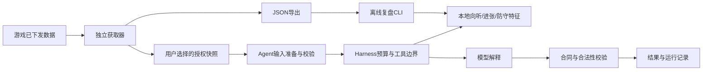

# Majsoul AI Analysis & Review Agent：Agent、harness与获取器

Majsoul Agent 以用户自配 LLM API 的实时局面建议与独立决策追问为核心，牌谱复盘为辅助，获取器可单独使用。本文按 v0.10.1 描述组件边界；模型上下文与工具的详细合同见 [AGENT_SESSIONS.md](AGENT_SESSIONS.md)。

## 三个边界

| 组件 | 职责 | 实现 |
| --- | --- | --- |
| Collector | 旁路采集、归一化、状态推导、面板、历史与JSON导出 | `protocol.js`、`capture.js`、`state.js`、`history.js`、`collector/controller.js`、`collector/browser-adapter.js`、`overlay.js` |
| Agent | 按任务制定固定工具计划，连接本地证据、模型解释和结果校验 | `extension/agent.js`，复用`analysis.js`与`mahjong-analysis.js` |
| Harness | 工具注册校验、执行预算、取消、超时、运行轨迹；提供离线复盘与回归评测入口 | `extension/harness.js`、`agent/review.cjs`、`agent/eval.cjs` |



外层执行流程为快照校验、分析准备、模型解释与结果校验；本地复盘只执行前两步。模型解释阶段使用实际 Pi Agent loop，可在预算内自行选择已注册的只读工具，再输出结构化建议；不执行任意代码或自动打牌。实时自动分析每次提供当前完整授权局面、最近 4 条成功自动建议、最多 2 条更早防守／弃和摘录及重要事件；手动全局与冻结决策追问沿用各自完整上下文。

分析悬浮卡顶部提供「实时对局 / 牌谱复盘」切换，无需展开获取器。实时模式使用最新收到的实时局面；牌谱模式可选择玩家视角、逐事件前进或后退、回到本局开局，只分析游标之前的局面。游标独立于雀魂播放器，需手动与游戏画面对齐。两种来源分别保留状态，切换模式不停止采集；切换来源会清除旧建议并取消在途分析，移动牌谱游标也会取消在途分析。牌谱结果可标记悬浮卡内的手牌，不贴到游戏中的实时手牌上。未载入牌谱时显示载入说明。

## 执行规则

标准输入是`contracts/snapshot.js`定义的`mj-analysis-v1` DTO，合同同时负责牌面规范化与逐字段白名单。Agent直接使用合同，不依赖获取器state或浏览器API；陌生采集器可直接提供相同DTO。`collector/snapshot-adapter.js`独立负责获取器state与用户授权范围的映射。`analysis.js`只处理任务、提示词、本地计算准备和结果解析；endpoint与权限模式在`adapters/model-endpoint.js`。默认不调用模型。本地分析使用自家手牌与公开信息；开启模型并确认统一数据授权后，按功能准备模型输入，对手暗牌和未知字段不进入分析输入。

controller持有实时、牌谱、历史和游标，通过注入端口取得存储、时钟、ID和hash；视图与导出为复制数据。`overlay.js`只展示视图并调用controller命令。`apps/collector-app.js`组合独立获取器；`apps/agent-app.js`额外挂载分析面板，传入`snapshot(selection)`函数、座位标签、阶段、局数及游标上下文。分析面板不读取采集器内部布局。销毁时取消在途模型、使准备和模型响应失效；重新挂载重新绑定监听并读取配置。

- 执行前核对完整计划中每个工具是否注册；默认预算6步，最多允许16步。当前在线计划实际为4步。
- 默认25秒，允许的最长预算60秒；取消或超时后不执行后续工具，忽略晚到结果。同步计算不能被JavaScript定时器强制抢占，本地算法自身保留计算边界与缓存。
- `background.js`仍负责扩展身份、主机权限、配置和API密钥。Agent只接收授权快照与注入的模型传输函数，不读取密钥或任意文件。
- 每次执行先复制并清洗输入；本地计算和提示词使用同一份快照。界面继续使用既有指纹标记旧局面结果。
- `majsoul-run-v1`轨迹只记录工具名、状态和相对耗时。不写入牌局原文、模型原文、密钥、请求地址或任意错误文本。成功运行可在面板查看轨迹；失败和取消轨迹由harness附在异常上，当前界面仍显示简短错误。

## 两种安装方式

```sh
npm run build
python scripts/package-public.py
```

前者使用`extension/profiles/agent.json`和`collector.json`，在`dist/`生成`majsoul-ai-analysis-and-review-agent-<version>/`和`majsoul-collector-<version>/`；后者先检查和测试，再生成完整源码、两种安装ZIP和SHA-256文件。获取器只含必要的采集、状态、历史、展示代码与原创牌面。其后台仅处理历史记录，没有模型监听器、分析模块、设置页或可选模型主机权限。

构建按各profile的资源依赖闭包复制文件，不对共享UI做字符串替换。默认`extension/manifest.json`与agent profile一致。`npm run check`验证静态模块边界、纯核心不访问浏览器能力、资源完整性及加载顺序；collector闭包不能引入分析或模型文件。新增模块需同步显式入口与静态依赖规则。

视图仅暴露回放记录数量与有限的最近事件，完整记录通过导出获取；UI每次渲染只读取一次复制视图。具体依赖规则和静态检查局限见[可执行的模块边界](DECOUPLING.md)。

同一页面只启用一个版本，避免重复观察连接。两种扩展存储独立。独立集成可使用JSON导出与离线复盘；可选 mjai 后端提供仅监听本机的 HTTP 桥接服务，不提供 MCP 服务器或跨扩展实时 RPC。

## 可选 mjai 工作流

LLM 分析和解释仍是主要用途，默认 `chat` 且分析关闭。设置分别保存一份 `chat` 和 `mjai` 配置，一次只运行选中后端。扩展不内置模型。0.10.0 源码包提供 Akagi v2 固定小型 Mortal 示例的官方下载、校验与启动路径，已在限定 Windows CPU 环境完成真实权重验收；其他模型、版本及实战牌力不据此视为已验证。模型、依赖与许可须单独准备，步骤与范围见 [MJAI.md](MJAI.md)。

`adapters/mjai.js` 从用户授权的 `mj-observer-v1` 本局连续事件生成 `majsoul-mjai-v1`，匿名化玩家名并遮蔽对手暗牌和摸牌。`engine-agent.js` 只消费净化快照和请求，执行 `request.validate → engine.infer → engine.validate`，独立重放自家手牌、副露及补牌并核对公开局面与决策阶段。支持可连续重放的四麻，拒绝自家14张开局、轮转缺口、错配局面和不能证明的动作。`dahai` 受手牌、本地候选与鸣牌后食替约束；`reach` 仅在 `followUp` 弃牌经验证时显示宣言牌，否则保留 `tile:null`；`none` 仅在响应阶段出现。吃碰杠核对来源、用牌及阶段；抢杠、自家立直后杠、多人四杠后继续对局、对手五暗杠赤牌组成未知等保守拒绝。对手已发生的合法立直后暗杠可重放；牌山只检查已知上界。

荣和／自摸依赖同一步实时操作资格与本地和牌形，荣和另查自家牌河振听；完整役与临时／立直振听资格依赖游戏提示，不宣称独立完整计算。`availableActions` 只在实时当前步、同座位且授权对局时保留，过期、断线和换座位清除；普通 LLM 请求及初始基线排除此引擎资格字段。动作、阶段与已验证配套弃牌保留于冻结历史和追问，动作牌不标为弃牌。响应建议需手动触发，自动仍限原有自家弃牌点。Q 值无可靠映射时不展示候选，不当作放铳概率或危险证据。上述能力纳入 0.10.0，本轮未做真实完整牌谱验证。

`agent/mjai-process.cjs` 启动可信用户命令，以一行完整事件数组输入、单行动作输出的 JSONL 协议完成一次推理，再清理进程。`agent/mjai-python-wrapper.py` 仅包装用户零参数 Bot 类及 `react(events_json)` 接口，用户模块负责加载权重。进程不是沙箱；获取器不包含这些能力或依赖。`engine-server.cjs` 提供带 Bearer Token 的本机 `/analyze`，全局单次推理，忙时429且不排队；`engine-review.cjs` 从导出事件前缀重建快照，调用相同的引擎 Agent 和完整快照/动作校验，输出结构化结果与脱敏轨迹。配置、命令及限制见 [MJAI.md](MJAI.md)。

## 复盘与评测

```sh
npm run review -- observation.json --seat 0 --hand --cursor 12
npm run review -- observation.json --task danger
npm run eval
```

复盘CLI的输入边界接受获取器导出的`mj-observer-v1`对象，重建所选局面后通过`collector/snapshot-adapter.js`转为标准DTO交给Agent。牌谱模式只应用游标前的事件，不使用导出对象里的最终状态推测过去；自家手牌默认不参与，需显式`--hand`。实时模式使用导出时的局面，不从可能截断的最近事件列表伪造完整回放。Agent本身只消费DTO。CLI只计算本地结果，不调用模型，输出`majsoul-review-v1`。

`npm run eval`运行3个人工向听样例，通过同一Agent与harness输出`majsoul-eval-v1`报告；失败时进程返回非零。它是执行链与本地结果的回归检查，不是模型牌力评估。新分发组合的浏览器模拟验收见[验证记录](../VALIDATION.md)；真实牌谱集、逐动作标注、模型质量与实战表现仍待补充。
