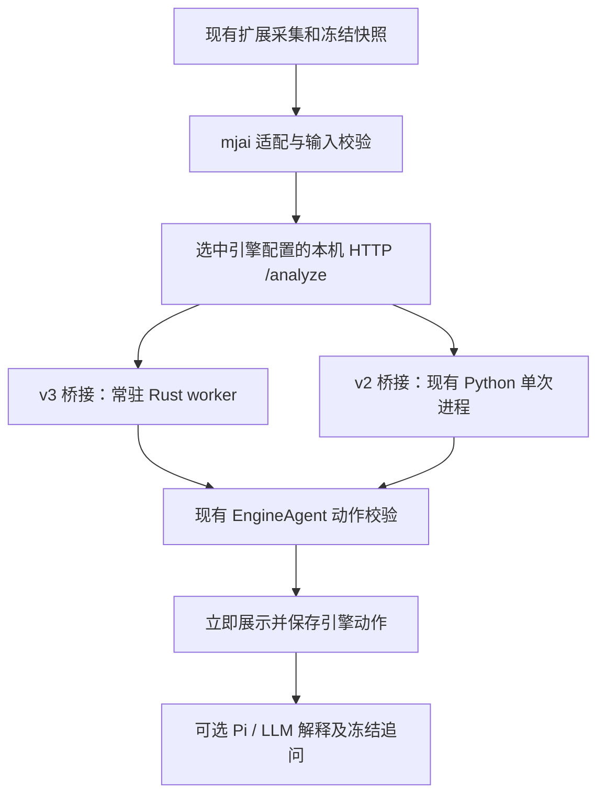

# Akagi v3 模型接入方案：新增 v3，保留 v2

日期：2026-11-04。状态：**暂缓实施；尚未接入或完成性能／牌力验证**。

用户已调整优先顺序，当前以 [VoidShine Mortal v4 接入方案](VOIDSHINE_MORTAL_V4_IMPLEMENTATION_PLAN.md) 为准。本文保留原设计，不作为当前实施任务；模型和原生推理进程仍须用户主动选择，默认关闭。

## 结论与范围

新增 **Akagi v3 Native 四麻模型**作为可选本地引擎，同时保留 **Akagi v2 弱 Mortal 示例**和自定义 mjai 服务。继续使用本项目的浏览器扩展采集、标准快照、动作校验、冻结决策及 LLM 教学链路。

推荐以独立 Rust 推理程序接入 v3 的 `native_bot`，复用现有本机 Node HTTP 桥接。v3 程序常驻、权重一次加载；每次请求重置牌局并重放完整事件前缀，避免跨标签页、回看游标或换座位导致状态串用。v2 保持现有 Python 路径，不要求其用户迁移。

首期交付包含：Windows x64、CPU 推理、四麻、手动切换两种本地引擎、现有自动弃牌点分析，以及可选 LLM 自动解释与冻结追问。新用户的本地引擎起步文档优先介绍 v3；项目默认仍为关闭分析的 Chat 配置，旧用户不自动换模型。

三麻模型虽由上游提供，但本项目的 mjai 输入、状态重放及动作合同目前限定四麻。本期不开放三麻、AutoPlay、CDP／MITM 采集、Akagi 桌面界面或其云端推理服务。模型接入与完整桌面平台迁移是两个独立项目。

## 已核对的依据

本方案固定研究 Akagi 提交 [`1fb16453ae0b7b0a820510ea1d3dbd01b6939082`](https://github.com/shinkuan/Akagi/tree/1fb16453ae0b7b0a820510ea1d3dbd01b6939082)，不按浮动 `v3` 分支下载发布资产。

| 项目 | 核对结果及设计影响 |
| --- | --- |
| 模型身份 | `native_bot` 是行为克隆 CNN，不是 Mortal；四麻权重为 `akagi4p.safetensors` |
| 运行依赖 | `native_bot` 使用 candle 与 riichienv-core；不需要 Tauri、浏览器或 Python 才能推理 |
| 特征与模型 | 四麻输入 39 × 34；需配套 observation 编码、动作解码和状态适配，不能单独替换 `mortal.pth` |
| 生命周期 | `Engine::reset()` 保留模型；`set_seat()` 可设置座位；可用 `feed()` 重放后调用 `decide()` |
| 输出 | `BotAction` 含弃牌、立直、鸣牌、和牌等；立直首选携带配套弃牌；还可能输出本项目暂不支持的九种九牌／拔北 |
| 候选含义 | 候选来自合法动作上的策略分布，不是胜率、放铳率或解释文本 |
| 协议风险 | `feed_line()` 会跳过无法建模的事件；不能把其宽松跳过行为直接当作本项目的严格重放 |
| 规则风险 | `Engine` 初始化为 `GameRule::default_tenhou()`；雀魂规则差异需实测和限定，不能据支持 mjai 推定完全一致 |
| 许可 | 上游根目录 LICENSE 为 Apache-2.0，`native_bot/Cargo.toml` 同样声明 Apache-2.0；模块文档说明继承项目许可 |

直接来源：[引擎接口](https://github.com/shinkuan/Akagi/blob/1fb16453ae0b7b0a820510ea1d3dbd01b6939082/native_bot/src/engine.rs)、[模块说明](https://github.com/shinkuan/Akagi/blob/1fb16453ae0b7b0a820510ea1d3dbd01b6939082/native_bot/README.md)、[特征编码](https://github.com/shinkuan/Akagi/blob/1fb16453ae0b7b0a820510ea1d3dbd01b6939082/native_bot/src/obs.rs)、[训练说明](https://github.com/shinkuan/Akagi/blob/1fb16453ae0b7b0a820510ea1d3dbd01b6939082/native_bot/train/README.md)、[LICENSE](https://github.com/shinkuan/Akagi/blob/1fb16453ae0b7b0a820510ea1d3dbd01b6939082/LICENSE.txt)、[NOTICE](https://github.com/shinkuan/Akagi/blob/1fb16453ae0b7b0a820510ea1d3dbd01b6939082/NOTICE)。

本项目依据：`agent/akagi-local.cjs`、`agent/akagi-local.py`、`agent/mjai-process.cjs`、`agent/engine-server.cjs`、`extension/contracts/engine-result.js`、`extension/model-config-store.js`、`docs/MJAI.md`。目前仅 Chat 有命名配置集合，mjai 只有一个草稿槽位；引擎结果已支持模型名、运行时、checkpoint 哈希及来源提交。

## 用户使用方式

设置页保留 Chat／本地 mjai 两种服务类型。在本地 mjai 下新增可保存的引擎配置，起步项为：

| 配置 | 建议默认地址 | 本机要求 |
| --- | --- | --- |
| Akagi v3 Native（四麻） | `http://127.0.0.1:17342/analyze` | Node.js 与项目提供的预编译 Rust 推理程序 |
| Akagi v2 Mortal 弱示例 | `http://127.0.0.1:17341/analyze` | 保持原 Python 3.11／PyTorch 组合 |
| 自定义 mjai 服务 | 用户填写 | 由用户服务决定 |

地址和端口可修改；选择配置只切换保存的地址、Token、模型身份期望和教学开关，不代表对应服务已经启动。用户可只运行一个服务，也可同时启动两者后在扩展中切换。两个服务各有独立 Token。

v3 首次使用流程：下载本地引擎工具包 → 校验并安装固定模型资产 → 运行真实推理检查 → 启动桥接 → 将地址与 Token 保存到扩展 → 明确启用分析。普通用户不用安装 Rust 编译器、Python 或 PyTorch；开发者从源码构建时需要 Rust。

建议新增命令如下，均为**拟议接口，当前尚不存在**：

```powershell
npm run engine:akagi-v3 -- setup --dir research/evidence/akagi-v3
npm run engine:akagi-v3 -- check --dir research/evidence/akagi-v3
npm run engine:akagi-v3 -- serve --dir research/evidence/akagi-v3 --port 17342
```

现有 `npm run engine:akagi -- setup/check/serve ... --python ...` 继续表示 v2，参数和默认端口不变，避免已有脚本被解释成 v3。

展示统一使用“本地引擎决策 + LLM 解释”，卡片显示实际身份，例如“Akagi v3 Native · 四麻”或“Akagi v2 Mortal · 弱示例”。解释注明依据可见事实生成，不是读取神经网络内部思考。

## 架构与运行机制



### 1. Rust 推理程序

新增 `engines/akagi-native/`，仅引入固定提交的 `native_bot` 推理必要源码及权重，保留上游文件的许可及改动标识；不引入整个 Tauri 应用，也不重新用 JavaScript／Python 仿写特征编码。保留上游目录为独立第三方组件，本项目 wrapper 单独存放。

使用受审查的依赖锁；核对上游实际解析的 riichienv-core／candle 版本后生成并提交本地 `Cargo.lock`，构建使用 `--locked`。不能只照抄宽松版本声明并假设未来解析结果一致。

worker 启动时加载固定模型并发出有界 `ready` 消息，包含协议版本、模型身份与支持模式。每次分析依次执行：

1. 校验请求版本、ID、座位、体积及事件白名单。
2. `reset()` 清空牌局状态，`set_seat()` 设置本次座位，保留已加载权重。
3. 通过显式转换表重放完整事件前缀，区分 envelope 元数据与必须应用的牌局事件；未知或无法表达的必要事件明确失败，不静默跳过。
4. 只在最终授权局面执行 `decide()`；缺少可决策动作时返回结构化错误，不把它伪造为可跳过。
5. 将 `BotAction` 映射为本项目动作合同，返回动作与可校验的身份信息。

首期使用单 worker、串行请求，不做跨请求增量事件缓存或多模型服务池。权重常驻解决重复加载成本，重放完整事件前缀保留请求隔离；后续只有基准证明重放成为瓶颈时再考虑增量同步。

### 2. Node 常驻 runner 与 HTTP 桥接

新增 `agent/akagi-native-process.cjs` 实现现有 `infer(request, {signal})` 端口。继续复用 `createEngineServer({runner, token, identity})`；当前 `startEngineServer({config})` 只能创建单次进程 runner，需要新增可注入 runner 的启动路径，保持旧调用兼容。

Node 与 Rust 之间新增私有、有版本的 JSONL envelope，包含 requestId、seat、events；不冒充通用 Bot 插件协议。每行一条响应，stdout 只用于协议，stderr 只记有界诊断。HTTP 外层维持原 `/analyze` 与 `{format, seat, events}` 请求，不为模型选择扩大游戏数据合同。

生命周期要求：

- 服务启动完成模型校验和实际推理检查后才进入可用状态；check 成功必须实际执行模型，不能只检查文件存在。
- 冷启动超时与单次推理超时分开；HTTP 分析仍服从现有 25 秒客户端预算。
- 同时只处理一次请求，繁忙时沿用 429，不无限排队。
- 请求取消、推理超时、损坏输出、协议错位或 worker 异常时终止并清理整棵进程树，清理结束后才释放槽位；不得向后续请求交付旧响应。
- worker 重启后重新校验／预热，不在同次失败请求中自动重试；非就绪状态快速返回明确不可用错误。关闭服务时同时回收 worker。
- 只监听 loopback，继续沿用 Bearer Token、来源校验、输入输出限额与脱敏错误；不记录手牌载荷和 Token。

v2 继续使用 `mjai-process.cjs`，不顺便改造成常驻 Python。本期不在 v3 失败时自动改用 v2 或 LLM 决策；用户明确选择的模型必须与实际动作来源一致。

### 3. 动作与规则映射

复用现有扩展合法性校验，Rust 的“合法”不直接替代本项目校验。

- 普通弃牌、吃碰杠映射实体牌、来源座位及摸切；赤五／普通五重复副本须与重放后的自家手牌一致。
- `Reach {pai}` 转换为 `action: reach` 与 `followUp: dahai`，其中摸切标志根据同一冻结局面验证；缺少可证明的配套弃牌时拒绝，不猜测。
- `Hora {target}` 映射后仍需同一步雀魂实时和牌资格、和牌形及现有振听检查。引擎没有显式给出的和牌字段只能从本次已校验事件中补足。
- `Pass` 仅在可证明的响应阶段映射为 `none`；自家弃牌阶段没有动作属于失败。
- 九种九牌、本项目未支持的抢杠、立直后杠等动作明确报告不支持，不在桥接层选第二名替代。
- 逐项检查 `start_kyoku` 点数／供托、立直成立、副露、补牌、摸切、赤五与未知对手暗牌的转换；有输入无法可靠表示时拒绝。

上游 `decide()` 自带若干解码策略，例如无法生成立直弃牌时可能移除立直首选。第一阶段应记录这类上游行为并验证与固定上游一致；“不替换动作”指我们不能在桥接或扩展校验失败后擅自换选，不宣称能恢复上游未输出的原始策略。

规则检查是实施前置门槛：核对上游默认天凤规则与现有支持的雀魂四麻场景。可配置时显式适配；不可配置或无法验证时限制支持范围并报告。不可仅凭模型返回动作就宣称完整雀魂兼容。

首期只展示经校验的最终动作，继续使用 `candidates: []`。策略候选与概率展示单独后续实现，需要固定动作映射、逐项校验及明确标签；不得把 softmax、logit 或 Q 值显示为放铳率／和牌率。

### 4. 模型身份与配置迁移

复用结果已有 `identity.model/runtime/checkpoint/sourceCommit`；checkpoint 为权重 SHA-256，sourceCommit 为固定上游提交。桥接身份必须来自经校验的运行资产，不能由用户输入的显示名称冒充。

建议新增纯模块 `extension/engine-profiles.js` 与存储 `mjaiEngineProfilesV1`：保存引擎配置列表、activeId、endpoint、Token、workflow、来源预期。沿用 `modelConfig` 作为唯一运行时配置，`analysisProviders.mjai` 继续作为兼容槽位。

旧 mjai 配置完整迁移为“原本地引擎”，保留地址、Token、教学开关与启用状态；未知服务不得猜成 v2。Chat 命名配置和独立解释服务不改写。新增预设与手动切换仍需保存，切换不自动开启分析，并取消旧配置的在途动作／解释。

已知 v2／v3 预设在结果提交前核对期望模型与来源清单；缺少身份或身份不符时不把结果保存为所选模型。自定义服务可保持身份未知并如实展示。来源为桥接声明与本机文件验证，不是远程认证。

### 5. 教学与历史兼容

界面及新记录采用通用工作流 `engine-explain`，内部统一判断两种值，继续识别历史 `mortal-explain`。读取旧记录时不改其模型身份或动作；新写配置使用通用值。同步覆盖设置校验、后台 worker、讨论与会话存储、解释重试、面板展示、关闭清除流程，避免只改设置页造成其他入口失效。

动作先校验、展示并保存，LLM 随后解释；解释失败只重试解释，冻结追问不调用模型引擎。历史记录保存本次动作、引擎身份及解释配置引用；切换 v2／v3 后，旧讨论仍标识原动作来源，不重新解释为新模型建议。官网 Mortal 报告导入保持原来的独立含义，不改名为 Akagi 报告。

## 下载、构建与分发

新增 v3 来源清单，固定源码提交、必要文件、权重 SHA-256、编码布局版本、协议版本、运行平台和许可证；下载后校验再原子安装，失败不覆盖现有可用资产。哈希需实施时从固定来源实际取得并复核，本方案不填写未测值。

提供独立 Windows x64 本地工具包，包含 Node 启动脚本、预编译 Rust worker、来源清单及许可；沿用现有 Node.js 22.19+ 要求。权重由显式 setup 安装，扩展 ZIP 不携带原生程序／权重。核对固定上游 `include_bytes!` 行为，构建时改为明确加载外部固定权重，移除默认嵌入入口并记录改动，使工具包与资产分离。

Rust、candle、riichienv-core 等构建依赖由维护者／CI 准备，普通用户不在本机编译。发布时同时校验工具二进制与权重；分别固定两者身份，避免“旧程序 + 新权重”静默混用。安装检查同时验证加载、真实推理和版本兼容。

保留 v3 的 Apache-2.0 LICENSE、适用 NOTICE、组件来源及修改说明；项目自有代码继续使用现有 MIT。v2 独立下载及许可流程不变，不把 v2 资产的条款改成 Apache-2.0。所依赖组件和权重目录是否存在额外声明，在首次固定资产时一并核对并记录；采用已有权重，不重新抓取训练牌谱。

## 实施顺序与交付物

| 阶段 | 工作与主要文件 | 完成门槛 |
| --- | --- | --- |
| 1. 独立可行性验证 | 固定来源清单；`engines/akagi-native/`；事件转换表及规则差异记录 | 四座位真实权重推理；关键事件转换覆盖；与固定上游同输入同动作；确认规则／暗牌重放可用性 |
| 2. 本机服务 | `agent/akagi-v3-local.cjs`、`agent/akagi-native-process.cjs`；兼容扩展 `engine-server.cjs`；新增 npm 命令 | 模型只加载一次；重复请求、历史分支及取消／崩溃恢复隔离；HTTP → EngineAgent 真实动作通过 |
| 3. 配置与教学 | engine profiles、config store、options、后台 worker、结果身份、讨论历史和解释工作流 | v2／v3 可保存切换；旧配置和历史无损；模型不误标；教学与追问复用 |
| 4. 验收与发布 | 定向测试、Rust 构建、真实链路报告、独立工具包、来源和使用文档 | 满足下列验收门槛；v2 回归通过；发布限定兼容范围 |

阶段 1 若发现规则或事件无法可靠重放，应先解决或缩小声明范围，再进入发布；不通过改动动作校验把问题隐藏掉。

## 验收与比较方法

### 必须通过的工程验收

- **v2 兼容**：原 setup/check/serve 命令、固定文件校验、Python 推理、动作、取消与已有教学功能继续可用。
- **v3 正确接入**：四座位、弃牌、赤五、立直配套弃牌、响应跳过、吃碰杠及补牌、鸣牌后弃牌、受资格约束的荣和／自摸；不支持情形按合同拒绝。
- **编码一致性**：固定上游与 wrapper 对同一事件流产生一致结果；保留上游数值 parity 检查，并增加实际事件到特征的对照，数值接近不替代特征语义检查。
- **隔离与恢复**：A → B → A 请求、换座位、同局不同游标、不同标签页／对局、取消后新请求与 worker 崩溃重启；同一冻结输入不受前序请求污染。
- **配置与历史**：旧 mjai／Chat 配置迁移、两套 Token、模型身份错配、撤权、切换取消、刷新恢复；旧 Mortal 讨论与新 v3 讨论各自保持原身份。
- **完整链路**：真实 v3 权重 → Rust → 本机 HTTP → 扩展动作校验 → 展示。LLM 部分先用 mock 验证合同，真实模型解释质量单独报告，不能混称已验证。
- **真实游戏兼容**：在实际支持的雀魂四麻环境完成从开局到整盘结束的连续采集，检查关键阶段及采集缺口；人工局面与离线牌谱不能替代该项。
- **分发**：干净 Windows 环境无需 Python／Rust，可安装 v3 工具和权重并推理；扩展及独立获取器资源边界检查通过。

实施时运行相关 Node 定向测试、Rust 测试及真实模型验收脚本，再完成 `npm run check`、`npm test`、`npm run build`。发布工具包另验证锁定构建、资产哈希和干净环境安装。

### 延迟与模型质量分开评估

在同一机器、相同冻结输入集上，分别测 v2 与 v3 的冷启动、热请求、HTTP → 校验完成端到端 p50/p95、超时率、内存及合法动作交付率。记录样本数、硬件、事件长度、模型哈希和进程重启次数。

v3 暂定工程目标：100 个热请求，端到端 p95 ≤ 1 秒、无串局和进程残留；该目标不是实测承诺。如未达标，报告具体瓶颈，不把重复加载或重放耗时排除后宣传实时延迟。

用多个授权牌谱中预先冻结的相同决策点比较动作差异与专家／可靠参考评价；覆盖攻守、鸣牌、点棒状况和牌效率。参考首选一致率、动作合法率、解释质量分别报告，均不等于胜率。上游行为模仿验证集准确率不能当作麻将实战正确率。是否推荐 v3 作为本地首选依据安装便利性、稳定性、延迟和质量证据，不按版本号推断牌力更强。

## 后续可独立推进

三麻需要新的输入／动作合同和拔北、点数、赤牌及资格验证；v2 常驻化需要独立进程生命周期验收；v3 策略候选展示需要新候选合同。这些工作不作为本期首发的隐式依赖。
