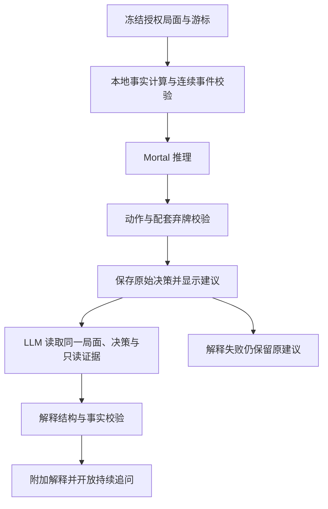

# Mortal 决策 + LLM 解释：现有产品功能适配研究

> 2026-11-01 实现补充：本文保留调研时点的历史结论；v0.13.0已整合有限串联与旧版报告适配。当前能力、实测与未验证范围以 [MORTAL_WORKFLOW_VALIDATION.md](MORTAL_WORKFLOW_VALIDATION.md) 为准；本文“尚未实现”不表示该补充之后的代码状态。

日期：2026-10-30。状态：调研与建议，尚未实现。

## 产品基线与结论

初步研究先按公开的 [README.md](../README.md)、[AGENT.md](AGENT.md)、[AGENT_SESSIONS.md](AGENT_SESSIONS.md)、[USER_MEMORY.md](USER_MEMORY.md) 对照已实现能力。用户随后指定实际产品基线为 [PRODUCT_PRD.md](../research/evidence/context-optimization-20261026/PRODUCT_PRD.md)，本轮已更新为 1.3.0；该文件位于 ignored 的研究目录，描述目标产品行为，不等于当前实现。本研究的配置及接口建议应服从其旧卡保持、来源原子替换、冻结讨论、通道隔离和验收规则；公开架构中的早期描述不替代专项文档与实际实现。

用户已明确新方向：**Mortal 先给出动作答案，再调用 LLM 解释。** 建议将其做成一种可选“分析模式”，与现有 LLM 分析并存；首次建议在该模式下自动串联两阶段，不要求用户切换后端才能追问。

这契合“看懂每一次取舍、随时追问为什么”的核心功能。但 LLM 只能基于可见局面、本地计算和模型输出给出教学解释，不能恢复 Mortal 的内部思维。模型接入来源、权重和进程协议研究见 [MORTAL_INTEGRATION_RESEARCH.md](MORTAL_INTEGRATION_RESEARCH.md)；官网 4.1 权重或授权接口目前仍未取得。

## 功能逐项适配

| 现有功能要求 | 串联模式建议行为 | 缺口与实现重点 |
| --- | --- | --- |
| 实时悬浮卡显示建议 | Mortal 动作验证成功后先显示“建议打 X / 立直 / 碰”等，随后补入 LLM 解释 | 当前消息只返回最终结果，需增加可校验的阶段通知和 UI 状态 |
| 首选、候选、理由 | 首选取最终 Bot 动作；解释展示可核对的向听、进张、风险证据和取舍 | 当前引擎候选为空；有可靠版本映射后再展示 Mortal 候选，不能用本地效率排序冒充 Mortal 排名 |
| 牌效率开关 | 本地向听、进张表继续工作；LLM 可围绕 Mortal 首选比较合法替代弃牌 | 明确“牌效率排序”和“引擎综合偏好”是两种信息 |
| 危险牌开关 | 用现有公开牌河及现物、筋、壁证据，由 LLM 解释风险 | Mortal Q 值不能生成放铳概率；当前风险等级校验继续生效 |
| 综合攻守开关 | 动作由 Mortal 决定；LLM 描述偏进攻、防守或弃和的取舍 | `dahai` 不等于进攻，不能沿用当前兼容 DTO 的默认 `attack` 当成模型策略标签 |
| 自动提示、起始巡目、间隔和次数上限 | 保留现有自家弃牌点触发及频率限制，一次提示触发一次串联流程 | 分开记录提示次数、引擎推理次数、LLM HTTP 次数，避免工具轮次绕过预算或重复扣次数 |
| 手动“分析当前局面” | 同一冻结局面上执行 Mortal → LLM，可解释吃碰杠或跳过响应 | 自动响应鸣牌点属于新增触发能力，首版不应顺带扩大 |
| 针对一个决策追问 | 直接使用原冻结局面、原 Mortal 动作、原解释和该决策的聊天历史 | 无需切换配置；默认不重跑 Mortal，不将最新实战牌面带入旧决策 |
| “为什么不打 Y” | 比较原首选与 Y 的本地效率和风险；有可靠引擎分数时补充偏好 | 没有候选分数时明确依据仅为局面比较，不能编造 Mortal 对 Y 的评分 |
| 回看历史巡目、刷新恢复 | 绑定同一 decisionId，原引擎答案不可覆盖，解释及追问附加保存 | 当前同位置存储有去重规则；需区分原始分析、补充解释与显式重分析版本 |
| 牌谱游标分析 | 只向引擎和 LLM 提供游标前信息；移动游标不自动调用 | 和牌资格等实时限制仍存在；无资格的离线和牌结果明确不支持，不能绕过 |
| 整场复盘 | 将保留样本中的引擎建议、解释与用户问题关联到原决策 | 当前是确定性样本索引，不是全场逐手引擎扫描；不得标成全场覆盖或胜率评估 |
| 用户记忆学习 | 记忆影响 LLM 解释重点，不修改 Mortal 策略；学习以真实用户动作为证据 | 当前 memory worker 在 mjai 配置下停用，需改为读取独立解释器配置并保留后台抢占规则 |
| 数据预览与授权 | 展示两阶段去向：本机引擎的事件流、LLM 的冻结局面和净化建议 | 引擎 token 与 LLM API key 分开保管；候选、元数据白名单化，不直接转发原始进程输出 |
| 用量与费用 | 展示引擎耗时、LLM 耗时、总耗时及实际 LLM usage | 本地推理不计作 LLM token；解释失败仍可能收费，未知费用保持未知 |
| 独立获取器、NAGA 导出 | 沿用各自入口与能力边界 | 新模块只能进入 Agent profile，不将模型运行时塞进 Collector |

只开启危险或效率分区、未开启综合攻守时，建议沿用本地计算 + 对应 LLM 专项解释，不要求运行 Mortal。Mortal 路径只负责综合决策；不能为了兼容内部 `task=combined` 而在用户关闭建议时偷偷改变产品行为。若用户启用综合建议又隐藏部分分区，引擎仍需要完整授权输入，隐藏分区不等于缩小数据授权。

## 运行流程及分阶段展示



阶段状态建议为“正在计算建议 → 建议已出，正在解释 → 解释完成”，并允许“已有建议，解释未完成”。解释失败时提供“重试解释”，仅重发 LLM 阶段；不重复加载模型或修改原首选。用户可在引擎结果出现后继续对局，不应因解释阶段仍 busy 而显示“请先不要出牌”。

建议在 Worker 内增加独立的 hybrid 编排，保留 `EngineAgent` 的推理与合法性合同，并抽取现有 chat transport / accounting / session 准备供解释器复用。不要由页面拼接两次不相关的最终结果，也不要在获取器中调用引擎。

现有 `sendMessage` + `sendResponse` 只承载一次最终响应，无法直接实现两阶段展示。可以新增后台到面板的阶段消息，所有通知绑定 runId、decisionId、冻结快照指纹、位置和配置修订；最终响应与阶段通知统一去重。端口、页面刷新或 Worker 中断时可恢复已保存的引擎决策，但不自动重发状态不明的付费解释。

局面在等待解释时变化：原建议立即退出当前牌面提示，但按 PRD 保持旧卡正文及来源可读并标记非当前，不因更新清空。旧解释即使允许完成，也只能附加至仍存在、授权允许的同一历史决策，不能盖回当前牌面或抢走正在阅读的 branch。是否取消及何时允许历史补解释应纳入 PRD 的通道调度设计，不能用不断取消导致实时或追问永久饥饿；隐私清除与授权撤回仍立即生效。

## 结果合同：动作和解释分别验证

建议新增组合结果外层，保留以下独立内容；字段命名属于方案，不表示当前 API 已支持：

```text
decisionId / snapshotFingerprint / position / authorizationRevision
engine: modelId、modelVersion/checkpointHash、phase、action、followUp
explanation: status、summary、evidenceRefs、comparisons、limitations
provenance: 引擎版本、解释模型、promptVersion、计算版本
timing / usage: 两阶段耗时、LLM 请求次数、token 与费用
```

首版解释器只返回解释，不重复输出一个可自行选择的主动作；页面从已验证 `engine.action` 渲染首选。若为了兼容现有结果格式而保留 `result.decision.tile`，应由编排层根据引擎投影，并做精确一致性检查，不能信任 LLM 生成的 tile。

仅在提示词中写“不要改答案”不足以保证一致性。需要结构上分离动作与解释，校验解释引用的牌、动作和证据；LLM 若提出质疑，单列“需要核对”，不可替换主建议。schema 校验不能完全验证自然语言牌理，仍需人工抽样，避免宣称所有解释都已被证明。

吃、碰、杠、和牌和跳过都不是普通弃牌。解释器应识别动作阶段，不能把 `pon` 硬解释成“打出某牌”，也不能在 `reach` 缺少 followUp 时补造宣言弃牌。当前通用 LLM schema 以弃牌及攻守为主，建议新增解释专用 schema，复用现有危险和效率的校验函数而不是原封不动复用整个 `parseResult`。

证据建议分为“引擎最终建议”“本地计算事实”“LLM 取舍解读”，例如：

> Mortal 建议打九万。本地比较显示，打九万后仍为一向听；下家已立直，九万是其现物。结合这些信息，这一选择可能是在维持推进的同时降低对下家的风险。它对其他玩家并不因此安全。

上例仅为表达示意，实际向听、现物和进张必须来自当时工具结果。不能把这段推测表述成 Mortal 内部推导，更不能说“模型算出放铳率为 X%”。

## 解释输入、工具与会话

保留真实 Pi loop 和六个只读工具。额外把净化、验证后的 engine DTO 放入本次结构化输入；需要时新增 `get_engine_decision` 工具，但不必为了再读一次已知首选强制增加一轮 HTTP。原始 stdout、Python 错误及完整未知 metadata 不进入 prompt。

首次解释使用与引擎相同的冻结快照和授权边界；详细效率与危险计算继续按需查询。自动提示仍使用现有有界历史摘录，手动与冻结追问保留各自上下文，不要每巡额外灌入整场 Mortal 原始日志。旧首选不能充当当前局面事实。

追问默认复用原引擎建议；问“如果当时改打 Y”只做当时局面下的比较，不构造不存在的后续牌山。需要重新跑其他 checkpoint 时，显式“用另一引擎重分析”创建新的分析版本，并记录其来源，不覆盖旧解释。

会话隔离维度在现有场次、小局、座位、lane、授权、分支及 LLM 配置基础上，增加工作流模式、引擎 checkpoint / 运行时标识、解释 prompt 版本。引擎缓存与 LLM 会话不能混为一体；缓存键还要包含事件前缀、规则和影响和牌判断的实时资格，不能只按手牌或游标缓存。历史冻结动作是“当时建议”，不是刷新后仍有效的操作资格。

原决策记录应在引擎通过校验后即可保存；后续解释附加写入。`decision-discussions.js` 当前同位置已有记录时直接返回旧记录，因此需增加阶段更新或解释版本，避免原记录永久只保留“等待解释”。若已有旧 LLM 分析占据相同位置，也需明确版本归属，不能让它吞掉本轮 Mortal 结果。

## 配置、预算和异常

建议配置分离“分析模式”和“服务配置”：分析模式可选 LLM、专业引擎、专业引擎 + LLM 解释；服务配置分别管理本地引擎与解释 LLM。保留现有用户配置并做明确迁移，新模式由用户启用。解释策略可选自动解释或按需解释，但用户所述主路径是自动解释。

当前 `analysisProviders` 虽已保存两份配置，`modelConfig` 却只有一个活动后端。新增模式需要修改后台路由、权限检查和配置失效逻辑，不能仅向 provider 下拉框增加一个字符串。解释器和引擎各自检查权限及有效配置；配置变化取消完整工作流，清除动作和解释两个阶段的当前资格。

预算应分别限制 engine timeout、LLM timeout 和整条工作流耗时，不能无界把原 25 秒串行叠加。当前后台 thinking 模式还可延长至 120 秒，不能将它作为实时解释默认；具体目标须在目标机器和真实服务上测量。首版可保留现有 LLM 请求轮次上限：实时最多 2 次、手动最多 3 次及最多 4 次只读工具，不承诺解释一次只花一个 HTTP。

模型应常驻以减少冷启动成本；建议先共享已加载网络、每次新建 Bot 回放当前局，降低状态串扰。引擎次数和 LLM 调用分开统计，后台记忆整理仍可被整个实时工作流抢占，不与实时解释争抢请求槽位。

| 情况 | 对用户可见的结果与后续动作 |
| --- | --- |
| 引擎不可用、事件缺口、非法或不支持动作 | 明确本次未取得有效 Mortal 建议；可供用户主动选择原 LLM 模式，默认不静默切换 |
| 引擎成功，LLM 超时 / HTTP 错误 / 输出校验失败 | 保留首选，标注解释未完成；可单独重试解释，费用记录仍保留实际尝试 |
| LLM 文字与首选矛盾或编造证据 | 拒绝挂载该解释，不改变已验证首选；必要时提示核对 |
| 游标移动、换局、换座、授权或配置改变 | 取消在途工作，旧结果不得更新当前提示；已保存历史留在其原决策 |
| Worker 重启或网络中断、付费请求状态未知 | 恢复原建议，将解释标为中断 / 未知；不自动重发 |
| 手动再次解释相同决策 | 复用已保存引擎答案，保存新的解释版本 / 尝试，不增加新的用户动作证据 |

## 代码改动范围与交付阶段

| 范围 | 主要文件 |
| --- | --- |
| Mortal 初始化、模型诊断、常驻 runner | `agent/` 下新增专用 profile / 服务实现，复用 `engine-server.cjs` 的 HTTP 合同 |
| 工作流配置与权限 | `extension/options.html`、`options.js`、`background.js`、endpoint adapters |
| 两阶段编排与解释合同 | 建议新增纯编排模块与解释合同，接线 `engine-agent.js`、`agent.js`、`analysis.js`、`harness.js` |
| 阶段状态、开关、预算、提示与追问 | `extension/analysis-panel.js`，以及读取建议的组合入口 / hand hints |
| 历史持久化、版本及会话隔离 | `extension/decision-discussions.js`、`round-context.js` |
| 用量和学习 | `extension/model-usage.js`、`agent-run-store.js`、`user-memory-worker.js`；必要时扩展 advice 的来源字段 |
| 复盘和分发 | `extension/postgame-review.js`、Agent profile / manifest、`scripts/check-boundaries.mjs`、对应产品文档 |

建议分三阶段实施：

1. **先验证引擎来源和推理**：明确具体权重与版本，打通真实 Mortal profile、四座位、立直配套弃牌与实际事件兼容。可先用现有弱版示例验证工作流，但不标为官网 4.1。
2. **完成产品最小闭环**：新增可选串联模式、首选先展示、自动解释、解释失败保留动作、冻结追问无需切后端、双阶段用量记录与取消保护。首版不依赖 Q 值候选。
3. **补强教学与复盘**：固定动作索引映射后增加引擎候选比较、引擎重分析版本和学习 / 复盘来源展示；是否提高牌理质量须以实测验证。

验收至少覆盖：Mortal 推荐 A 而 LLM 输出 B 不得改变主建议；解释超时仍保留 A；换局晚到解释不更新新牌面；历史追问读取旧快照且不重跑引擎；解释单独重试只增加 LLM 尝试；副露动作不被渲染为弃牌；危险 / 效率专项不因新模式报 combined 错误；关闭功能和清除配置取消两个阶段；刷新恢复不重复付费；记忆学习只统计实际用户动作；Collector 构建不含新模型模块。

本轮只完成源码对照和方案设计，没有以模拟测试宣称真实模型可用、解释正确或实时性能已达标。
