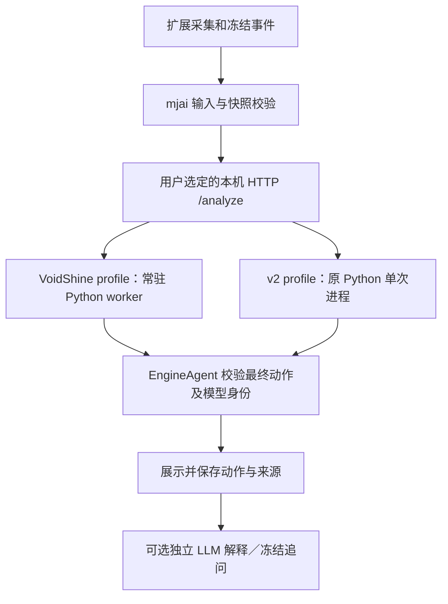

# VoidShine Mortal v4 接入方案：常驻推理，保留 v2

> **实施方案与记录。** v0.14.0 已提供实验实现，v0.15.0 更新便携启动与自动分析授权方式，v0.16.0 又加入独立 Akagi v3。下文保留原阶段目标；操作见[模型管理](../guides/MODEL_MANAGER.md)，完成与未测范围见[v4 验收](../validation/MORTAL_V4_VALIDATION.md)。

日期：2026-11-04。状态：**实验实现已随 v0.14.0 提供，v0.15.0 改用可选便携运行包；两个社区 v4 已严格加载、通过四座位／HTTP→Agent／关键动作与官方对照，实战与牌力仍未测**。执行详情见 [验收记录](../validation/MORTAL_V4_VALIDATION.md) 与 [模型管理](../guides/MODEL_MANAGER.md)。

历史实施顺序：本方案当时优先于 [Akagi v3 模型方案](AKAGI_V3_MODEL_IMPLEMENTATION_PLAN.md)，v3 曾暂缓，既有 v2 弱示例继续保留。后续 v3 已随 v0.16.0 作为第四项提供，不能再将“暂缓”视为当前状态，详见[v3 验收](../validation/AKAGI_V3_VALIDATION.md)。

<a id="实施后状态其余段落保留原设计与验收标准"></a>

### v0.14.0 实施后状态（其余段落保留原设计与验收标准）

- A/B/C阶段已完成：固定官方native与两个社区checkpoint严格加载；常驻单网络／每请求新Bot；HTTP、身份、配置、教学合同接线。
- 用户后续授权增加Yuchen1457/582500固定权重验证，已通过与298k相同四座位、100点、19关键／独立官方对照；两者共享经真实验证的v4 runtime，v2独立保留。
- 增加显式本机管理网页服务，目录与已安装资产分离，可零模型、按需只装一个、资产保留切换或删除；默认bootstrap无权重／无完整Python，未注册自启或Native Messaging。
- v0.14.0 当时采用逐次当前快照＋事件的手动半庄声明，两个 v4 自动分析暂关闭；v0.15.0 已改为提前说明四人半庄范围、不逐次确认，自动分析仍须用户主动开启，详见[当前流程](../guides/MODEL_MANAGER.md)。尾随 reach_accepted／dora 公告的拒绝与旧动作隔离按对应版本验收记录阅读。
- D阶段本机真实／故障／分发验收与对应源码公告落地；干净VM、真实整场、牌力和真实LLM教学仍未验证。最终通过数与产物见验收记录及交付信息，不把原计划中的待测目标当作完成证明。

## 1. 实施结论与用户约束

新增可选 **VoidShine Mortal v4 · 298k · 四麻半庄** profile。采用独立常驻 Python／PyTorch worker，模型一次加载；每次请求新建 `libriichi.mjai.Bot(engine, seat)`，重放当前小局的完整授权事件前缀，只返回当前决策。继续复用扩展采集、Node HTTP 桥接、EngineAgent 动作校验、冻结决策与 LLM 教学，不引入 Akagi v3 Rust 推理程序。

必须遵守用户明确要求：**模型、环境安装和常驻推理进程都是可选项，默认关闭**。

- 安装扩展、首次打开设置、升级、刷新网页、运行普通 Chat 功能，不下载权重、不安装 Python／PyTorch、不启动进程、不自动探测本机执行文件。
- 用户分别主动执行安装／检查／启动命令，再在扩展保存服务配置并明确开启分析。保存本地引擎配置不等于启动服务。
- 不注册开机启动、系统服务或计划任务。关闭桥接时回收 worker；不在后台静默保持模型进程。
- 项目默认仍是关闭分析的 Chat；旧用户继续原配置，不自动切成 VoidShine。切换到新预设或其他引擎时分析保持关闭，须保存并明确启用。
- 模型失败时明确报错，不静默换成弱示例或纯 LLM 决策。用户可以手动切回 v2。

首期范围：Windows x64、CPU、四人半庄、当前已支持的 mjai 动作和可选 LLM 解释／冻结追问。三麻、东风模型适用性、GPU、AutoPlay、CDP／MITM、更换采集器、重新训练均不属于首期。

## 2. 已确认的模型来源与边界

| 项目 | 核对结果 |
| --- | --- |
| 模型 | [VoidShine/mortal-298k](https://huggingface.co/VoidShine/mortal-298k) |
| 固定 revision | `dbbea7e3d34f99ec43fc4834ab7f2aaaed70b6ee` |
| checkpoint | `mortal_298k.pth`，130,774,416 字节，约 124.7 MiB |
| 上游 LFS 声明 SHA-256 | `bfb3a6c072aa0bfd4171a9cdc77cb6c02ae42cde920843f9e5784394f23447d8`；这是上游元数据，实施时须下载后本地复核 |
| 架构声明 | Mortal `version = 4`；ResNet 192 通道、40 blocks；298,000 训练步 |
| 适用范围声明 | 四人半庄，牌谱训练来源为天凤；作者说明未用东风数据训练 |
| 发布条件 | 公开、非 gated；模型仓库 LICENSE 和 model card 声明 AGPL-3.0 |
| 自报表现 | AI similarity 83%–92%、MAKA 平均 S+；缺少本项目可复核的样本／方法，不能作为验收结论 |
| 作者限制说明 | model card 明确不推荐排位使用；在设置帮助与文档保留该说明，不宣称官网同款或专业段位 |

`version = 4` 是 Mortal 模型／特征架构版本，**不等于官网 Mortal 4.1 权重、品牌认证或相同牌力**。实施后已本地复核文件SHA、内部v4/192/40配置、strict加载及真实运行；详见验收记录。

固定来源：[model card](https://huggingface.co/VoidShine/mortal-298k/blob/dbbea7e3d34f99ec43fc4834ab7f2aaaed70b6ee/README.md)、[配置](https://huggingface.co/VoidShine/mortal-298k/blob/dbbea7e3d34f99ec43fc4834ab7f2aaaed70b6ee/config.toml)、[许可](https://huggingface.co/VoidShine/mortal-298k/blob/dbbea7e3d34f99ec43fc4834ab7f2aaaed70b6ee/LICENSE)、[文件元数据](https://huggingface.co/api/models/VoidShine/mortal-298k/tree/dbbea7e3d34f99ec43fc4834ab7f2aaaed70b6ee)。

Mortal 运行时代码首先评估固定提交 [`0cff2b52982be5b1163aa9a62fb01f03ce91e0d2`](https://github.com/Equim-chan/Mortal/tree/0cff2b52982be5b1163aa9a62fb01f03ce91e0d2)。本轮已读 `mortal/mortal.py`、`engine.py`、`model.py` 与 `libriichi/src/consts.rs`：该提交有 v4 分支，原生端声明 `MAX_VERSION = 4`，官方推理入口采用 `torch.load(..., weights_only=True, map_location=cpu)`。这使其成为兼容验证候选，不证明训练作者使用的确切提交与它相同。

## 3. 与现有实现的复用边界

| 现有能力 | 本期处理 |
| --- | --- |
| `extension/adapters/mjai.js` | 复用完整事件、匿名化与对手暗牌遮蔽；不发送未来或对手隐藏信息 |
| `extension/engine-agent.js`、`contracts/engine-result.js` | 复用事件／快照一致性与动作校验，新增已知 profile 身份核验 |
| `agent/engine-server.cjs` | 复用 loopback、Bearer Token、来源校验及单并发；增加常驻 runner 的启动／关闭接线 |
| `agent/akagi-local.py` | 借鉴逐事件 react 和立直配套弃牌流程；原脚本继续只运行固定 v2 资产 |
| v2 `model.py`／`libriichi.pyd` | 不默认视为兼容；不通过改名覆盖旧权重，也不默认使用旧 DLL 加载新 checkpoint |
| `agent/mjai-python-wrapper.py` | 保留通用单次 Bot 包装器；新常驻协议单独实现，避免改变原插件合同 |
| 已有教学、历史、用量 | 复用动作先展示、解释后补、解释独立重试及冻结追问；记录真实模型身份 |
| 独立获取器／普通 Chat | 不新增模型依赖、原生启动入口或权限 |

## 4. 目标架构与模型生命周期



### 4.1 常驻 Python worker

新增 `agent/mortal-worker.py`，使用固定 Mortal 网络代码、匹配的 libriichi 及经哈希校验的 checkpoint。

启动时执行：

1. 核对 profile 清单、来源文件、checkpoint SHA-256、平台及运行库版本。
2. 以 CPU 和 `weights_only=True` 加载 checkpoint；读取其真实 `config`，核对 version=4、通道=192、blocks=40，以及 `mortal`／`current_dqn` 等推理所需内容。
3. 使用严格 `load_state_dict`，不通过忽略 missing／unexpected keys 或改网络尺寸绕过不兼容。外部 config 与 checkpoint 冲突时失败。
4. 网络设为 `.eval()`，非 oracle、关闭随机采样；CPU 首期关闭 AMP／compile。禁用训练、在线上传和 GRP 复盘分支，不要求训练数据、优化器或另一份 GRP 权重。
5. 发出有版本、有界的 ready 消息；记录模型、checkpoint、Mortal 源码提交、libriichi 构建和 Python／PyTorch 运行时身份。

模型的全局参数、推理开关和设备只在启动时确定，不允许牌局请求指定路径、模块、命令或下载地址。具体 Python／PyTorch／NumPy 版本在第一阶段实测后锁定，不能直接把旧 v2 的验证结论当作新组合已测。

每次请求创建全新 Bot，串行调用同一个只读推理 engine，逐事件重放完整当前小局前缀；历史中间建议只消化，不作为结果。返回当前最后一步的有效动作后销毁 Bot，权重保留在进程中。不同标签页、对局、座位、历史游标不复用 Bot 状态。

如果发现 `MortalEngine` 存在跨请求可变状态，先证明其能够可靠重置，或重新创建轻量 engine 包装而共享已加载网络；不能为了常驻假设所有对象无状态。

推理策略明确写入清单：首先按官方非 oracle 推理语义验证 quick-eval、和牌保护与确定性；任何与官方开关不同的选择都须记入 runtime 身份和验证报告，不能仅比较裸 Q argmax 就声称动作一致。

checkpoint 若不能按受限加载方式读取，输出明确错误并定位格式；不自动回退任意 pickle 加载。训练配置里的 `cuda:0` 不代表推理必须使用 GPU，CPU 是否满足实时预算以实际测试为准。

### 4.2 Node 常驻 runner 与失败恢复

新增 `agent/mortal-process.cjs`，实现现有 `infer(request, {signal})` 端口。Node ↔ Python 使用私有版本化 JSONL envelope，字段包括 protocol、requestId、seat、events；ready 与 result 类型分开，严格匹配 requestId，不把这个 envelope 作为通用 mjai Bot 插件协议。

HTTP 保持 `{format, seat, events}` → `{action, followUp?, identity?}`，地址仍为本机 `/analyze`。模型选择由本地启动配置与扩展选择的服务地址决定，不由游戏页面传入可执行参数。

- 启动服务时先完成模型真实推理检查，再监听端口；模型加载和 warm-up 不占正常分析的 25 秒预算。
- 请求一次只运行一个，忙时 429、不排队；非 ready 时快速返回不可用状态。
- ready 身份须与清单一致；HTTP identity 来源于已验证 worker，不硬编码一个模型名称就当作完成验证。
- 超时、取消、协议错位、输出超限及 worker 崩溃时终止并等待进程树清理，再释放推理槽位；丢弃迟到响应。
- worker 按有界退避重启并重新验证／预热；同一次失败请求不自动重试、不自动换模型。持续失败显示原因类别，等待用户修复或重新启动。
- 服务退出时终止 worker；重启恢复不能留下孤儿 Python 进程。冷启动、请求和清理分别有预算，实际数值第一阶段测定并设明确上限。
- 日志只记阶段、耗时与脱敏错误码，不输出 checkpoint 内容、手牌、完整事件或 Token。

## 5. 用户配置、安装与默认关闭

在本地 mjai 下新增可保存的配置集合：

| 配置 | 建议端口 | 模型／环境 |
| --- | --- | --- |
| VoidShine Mortal v4 · 298k · 四麻半庄 | 17342 | 新的独立 Mortal v4 CPU 环境及 checkpoint |
| Akagi v2 Mortal · 弱示例 | 17341 | 现有固定 Python 3.11 环境，不改动 |
| 自定义 mjai 服务 | 用户填写 | 原有自备服务能力 |

端口可改，两项分别保存地址和 Token。保持 `modelConfig` 是唯一运行时真值，新增 `mjaiEngineProfilesV1` 保存列表；`analysisProviders.mjai` 留作兼容草稿槽位。旧配置按原样迁移为“原本地引擎”，保留启用状态与服务地址，不根据端口猜成 v2。新预设均关闭。

用户流程：显式安装工具／模型 → 真实检查 → 手动启动桥接 → 扩展选择 profile、保存地址／Token → 确认适用范围及数据授权 → 明确启用分析。关闭分析停止请求；关闭桥接才退出模型进程，两种控制在说明中写清楚。

计划命令如下，**已实现，须显式执行**：

```powershell
npm run engine:mortal -- setup --profile voidshine-298k --dir research/evidence/voidshine-mortal-298k
npm run engine:mortal -- check --profile voidshine-298k --dir research/evidence/voidshine-mortal-298k
npm run engine:mortal -- serve --profile voidshine-298k --dir research/evidence/voidshine-mortal-298k --port 17342
```

`setup` 仅在用户明确运行时准备模型和固定源文件；运行环境安装单独提供显式命令／工具包，不把它藏在 `npm ci`、扩展构建或测试前置步骤。普通用户路径使用独立 Windows 本地工具包及便携 Python、CPU PyTorch、预编译 libriichi；维护者构建原生库，用户不应被要求安装 Rust 编译器。工具包不随扩展 ZIP 捆绑。

开发验证期可通过明确的 `--python` 参数使用已准备好的环境；发布前需锁定便携环境和本地原生组件，实际验证无需全局 Python／Rust 的安装路径，不能把开发者机器可运行等同普通用户可用。

## 6. 适用范围与动作合同

### 6.1 四麻半庄范围

当前快照提供局风／局数，但不可靠提供整场东风／半庄模式。**不能把东一局当作东风，也不能看到南场才认为半庄。**

首期在 VoidShine 模式下增加对当前对局“四人半庄”的显式确认，绑定已知的对局上下文；换场、数据不连续或无法确认绑定时失效并要求重新确认。自动分析必须完成同样确认。无法可靠绑定时只开放手动分析，不在页面刷新后自动恢复未经确认的自动调用。此确认是用户声明，界面不能写成已自动识别；v2 和 Chat 沿用原行为。

若未来协议能可靠提供整场模式，再增加独立白名单字段及其测试。东风／三麻作为后续独立适配，首期不宣传支持。

### 6.2 事件与动作

继续使用完整、连续、截止当前游标的事件；对手暗牌统一未知，不使用未来局面、原始账号或训练数据。逐项验证未知摸牌、赤五、座位、点数、供托、立直成立、副露与补牌的原生处理。

立直返回 `action: reach` 时向本次同一个 Bot 追加实际立直事件，取得并校验 `followUp: dahai`。当前快照若已处于立直弃牌阶段，不重复追加立直。无法取得配套动作时失败，不猜弃牌。

吃碰杠、鸣牌后弃牌、和牌及跳过继续经 EngineAgent 校验。和牌还需同一步游戏资格；九种九牌、当前不支持的抢杠／自家立直后杠等明确拒绝。不在校验失败后挑第二名替代模型动作。

首期仍只交付最终动作，`candidates: []`。Q 值、mask 和 softmax 不显示成和牌率或放铳率；候选排名另设合同与验收。

## 7. 教学、模型身份及历史兼容

界面显示明确来源：“VoidShine Mortal v4 · 298k · 社区模型”，并保存 checkpoint、HF revision、Mortal 源码提交及运行时身份。现有 `identity.model/runtime/checkpoint/sourceCommit` 可承载主要字段；如果增加 modelRevision，需同步白名单、持久化和展示，不能让原始 metadata 绕过合同。

扩展对已知 profile 比较预期模型与来源；缺失、错配或只返回 v2 身份时拒绝保存为 VoidShine。自定义服务可标身份未知。桥接身份声明不是独立认证，但必须与本机实际校验的文件及 worker ready 一致。

保持“动作先验证并展示 → 可选 LLM 自动解释 → 冻结追问”。解释服务独立配置与授权，失败只重试解释，不重新调用引擎。历史保存原动作和模型身份；切换模型不改写旧建议或旧讨论。

沿用现有 `mortal-explain` 内部合同即可支持两种 Mortal，本期不强制重命名存储格式。界面可统一叫“本地引擎决策 + LLM 解释”；如果实现时新增通用 `engine-explain`，必须同时兼容旧值及所有设置、worker、会话、用量、重试和历史入口，不能只改 UI。

关闭／清除覆盖新增 profile 的 enabled 和 Token；关闭使在途请求失效，清除移除新增凭据。模型切换取消旧动作和解释，不让迟到结果贴到新局面；冻结历史仍按原授权与身份访问。

## 8. 固定资产、环境与许可

新增 `agent/mortal-source.json`，分别记录模型 HF revision、文件 SHA-256 与大小、官方 Mortal 源码提交、libriichi 构建来源／ABI／特征版本、Python／torch／numpy 锁定版本、推理开关、profile ID 与协议版本。

下载使用固定 revision 与哈希、临时文件／目录和原子安装；校验失败或目录存在未知同名文件时不覆盖可用版本。模型资产和原生环境保存于忽略目录；不提交 checkpoint，也不覆盖 `.venv-akagi`。官方源文件只按清单导入并保留许可及修改记录，避免运行训练、自动上传和任意用户 config 路径。

模型仓库声明 AGPL-3.0；Mortal 框架和原生库按具体提交许可执行，v2 旧资产的 Commons Clause 边界保持独立。本地工具包分发时附适用许可、来源、修改说明、对应源码及构建／依赖信息；不把上游重新标为项目 MIT。Python 和 PyTorch 等运行时也需附相应公告。

进程分离是工程边界，不能仅凭“独立进程”宣称所有许可义务都自动消失。模型权重的声明与第三方训练牌谱使用条件分别记录，本期不下载或重新利用训练数据。现有扩展自有代码和独立获取器不因本期无关改动更换许可。

## 9. 分阶段交付

| 阶段 | 主要工作和文件 | 验收门槛 |
| --- | --- | --- |
| A. 兼容性验证 | `agent/mortal-source.json`；独立环境；固定官方源码／libriichi；真实 checkpoint 检查脚本 | 本地哈希与字段符合预期；v4 能严格加载；四座位真实推理；立直和关键事件可运行；运行时版本可固定 |
| B. 常驻桥接 | `agent/mortal-worker.py`、`mortal-process.cjs`、`mortal-local.cjs`；兼容扩展 `engine-server.cjs`；npm 命令 | 权重只加载一次；请求隔离；HTTP → EngineAgent 真实动作；取消／崩溃／关服后无遗留进程 |
| C. 配置与教学 | engine profiles、config store、options、后台 worker、身份核验、半庄确认和历史 | v2／VoidShine／自定义切换；默认关闭；旧配置／历史可用；动作先显示和冻结追问不重跑模型 |
| D. 工程验收与分发 | Node／Python／原生回归、性能脚本、本地工具包、验证文档、来源公告 | v2 回归、100点热请求与进程回收检查、普通安装路径及资源闭包通过；明确真实游戏／质量证据范围 |

阶段 A 是兼容门槛，不用修改旧模型文件或放松合法性校验绕过；若官方候选提交与 checkpoint 不兼容，定位原因后固定另一有依据的提交并更新清单，不能使用浮动 latest 或悄悄换权重。

## 10. 验收清单与发布标准

### 必须完成的工程验证

- **真实模型**：实际下载并校验 checkpoint，严格加载权重，四座位经 HTTP → EngineAgent 返回校验通过的动作；不能只用 mock 或接口签名证明可运行。
- **官方一致性**：相同输入和推理开关下，对照固定官方网络／Bot 的动作；覆盖立直两步与规则保护。对照脚本不能只是再次调用同一个 wrapper。固定输入 logits／mask 数值或已知官方结果辅助排查，合法性与动作一致分别报告。
- **事件覆盖**：弃牌、响应、吃碰杠、补牌、鸣牌后弃牌、赤五、立直成立、受资格限制的荣和／自摸及拒绝场景；合成局面与真实牌谱分开标记。
- **隔离／清理**：A → B → A、换座位／对局／游标／标签页，取消后新请求、超时、错误ID、损坏输出、worker崩溃与服务退出；完成／报错后不能遗留孤儿进程或使用旧响应。
- **可选且默认关闭**：新安装、旧 Chat 升级、切换预设、刷新和关闭分析均不启动进程／下载资产；仅显式 CLI 启动时存在 worker，退出后消失。Collector 包不含模型配置、推理入口或模型主机权限。
- **配置与授权**：旧未知服务不被误认、两份 Token 不串用、清除／禁用完整生效、身份错配拒绝、半庄声明不被当作自动检测，缺确认时阻止对应自动分析。
- **教学兼容**：新模型动作先显示；LLM mock 验证解释合同及失败重试；真实 LLM 教学效果单独验证，未调用付费模型不声称已验证质量。
- **v2 回归**：旧 `engine:akagi` setup/check/serve 命令、哈希、真实推理、取消及既有教学记录继续可用，v2 资产和依赖不被覆盖。
- **分发**：独立 Windows 工具包能在未全局安装 Python／Rust 的环境运行，固定文件／二进制／ABI 校验通过，附可复现构建和源码资料。

实施时先运行相关 Node 定向测试、Python worker 和实际 libriichi 检查，最终完成 `npm run check`、`npm test`、`npm run build`。常规测试不联网拉取大模型；真实模型验收必须显式运行并独立记录。

### 延迟与牌力分别报告

在同机、相同冻结事件集上比较 VoidShine 与 v2：冷启动／warm-up、热请求端到端 p50/p95、超时率、内存、合法动作交付率及重启次数。冷热耗时单独列出，不能把进程常驻后的速度当作安装或启动耗时。

建议采用至少 100 个预先固定的不同热请求，覆盖四座位和不同事件长度；记录硬件和所有来源哈希。实时体验的初步目标为端到端 p95 ≤ 2 秒，且无超时／状态污染；这是待测目标，不是当前性能承诺。若达不到，先定位 CPU 线程、模型计算和重放开销，再决定是否仅限手动／离线模式，不能只增加超时宣称满足实时要求。

牌力／建议质量使用多个授权半庄牌谱的同点对照和可审阅评估，保留动作差异、进攻／防守与点棒场景。作者的相似度和 MAKA S+ 保留为作者声明；参考首选一致率不等于正确率或胜率，不预设社区模型一定比 v2／Akagi v3 更强。

真实网页整场采集、断线恢复、干净环境安装、实战牌力和真实 LLM 教学质量是独立验证项。当前若不能完成，明确记录未测，不以人工局面或模拟浏览器替代；可以交付标明限制的实验接入，但不能宣传完整实战兼容。

## 11. 暂缓内容及后续处理

- Akagi v3 的 `engines/akagi-native/` 是暂停时保留的未完成准备文件；本期不纳入构建／分发，也不为了整理而回滚其他人的文件。正式提交本期改动时只纳入本期明确文件。
- 保留 v2 弱示例便于回归和手动选择，本期不要求将 v2 同时改造成常驻进程。
- GPU、东风／三麻、更多 checkpoint、多 worker 并发、策略候选解释等在本期真实验证后独立设计。
- 若后续继续由子代理实施，沿用用户指定的 `gpt-6.1-sol / medium`；主代理负责验收和审查。本轮只更新方案，不恢复之前的实现任务。
